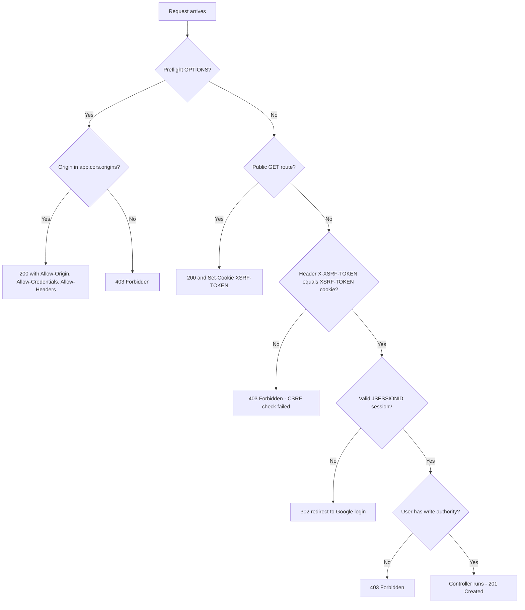

# Authentication, CSRF and cookies

How a write request (POST, PUT, DELETE) is checked by the backend, and which
cookies the app uses. Rules live in `SecurityConfig.java`.

## What the backend checks

## Why a CSRF token

The browser attaches cookies to every request to the backend, including ones triggered by another site. The session cookie alone therefore cannot tell a
real request from a forged one. A forged request cannot read the `XSRF-TOKEN` cookie, so it cannot copy it into the header, and the backend rejects it with a 403.
