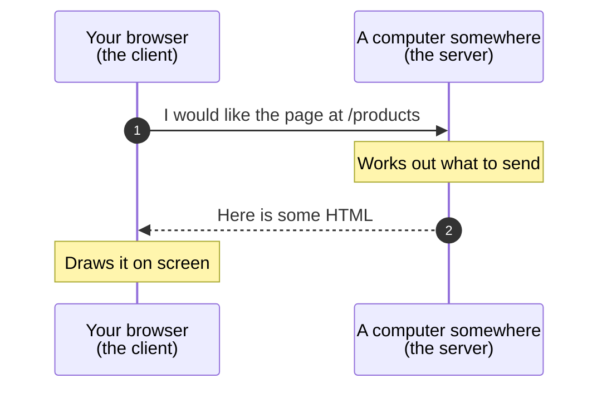

Start with something you have done thousands of times: you type an address into
a browser and a page appears.

## Two computers, having a conversation

There are always at least two machines involved.

**The client** is the thing in front of you — your browser, on your laptop or
phone. It knows how to ask for things and how to draw what comes back.

**The server** is a computer somewhere else that is always on, waiting to be
asked. It holds the actual information — the products, the accounts, the orders
— and decides what to send.



That is the whole shape. One side asks, the other answers, and then the
conversation is over. The server does not keep a line open to your browser; it
forgets you the moment it has replied.

:::note "Server" is a role, not a special machine
The server for this project is going to be your own laptop, running the code in
a container. Nothing about it is different in kind from a real one — same
software, same conversation. "Server" just means the side that answers.
:::

## What actually comes back

Text. That is the part people find surprising.

The server sends a document written in **HTML**, which describes what is on the
page:

```html
<h1>Products</h1>
<p>A nice mug</p>
```

Your browser reads that and draws it. Two more things usually come with it:

- **CSS** — what it should look like. Colours, spacing, sizes.
- **JavaScript** — code that runs *in your browser*, so the page can react
  after it has arrived: a menu that opens, a form that checks itself.

Three files, three jobs: what is on the page, what it looks like, what it does.

:::try See it for yourself
Open any website, right-click, and choose "View page source". Everything you can
see on the page is somewhere in that text — it arrived exactly like that.
:::

## Why any of this matters to you

Because it decides where your code runs, and that has consequences you cannot
argue with.

Code running **on the server** can reach the database and hold passwords. The
user never sees it — they only get its output.

Code running **in the browser** was sent to the user's machine, so they can read
all of it. It cannot hold a secret, and it has no direct line to the database.

Later, when this project makes you mark a file with `'use client'`, this is what
that is about. It is not a style choice. It is which machine the code lands on,
and therefore what it is allowed to do.
