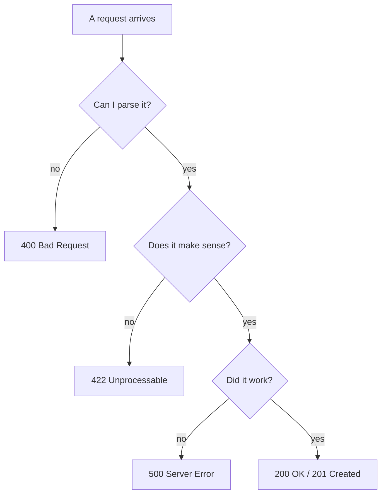

The conversation from the last step follows a fixed format, called **HTTP**. It
is worth twenty minutes because everything you build in this project is a
response to an HTTP request.

## A request

Every request has three parts that matter:

| Part | Example | What it is |
|---|---|---|
| **Method** | `GET` | What you want done |
| **Path** | `/products` | What you want it done to |
| **Body** | `{"name":"Mug"}` | Data you are sending, if any |

That is it. A request is a verb, a noun, and sometimes a parcel.

## Methods

There are several; you need two to start.

**`GET`** — "give me this." It should change nothing. Opening a page in your
browser is a GET.

**`POST`** — "here is some data, do something with it." Submitting a form that
creates something is a POST.

:::warn This distinction is not decoration
Browsers, caches, and search engine crawlers all assume a GET is safe to repeat
whenever they feel like it. If creating an account were a GET, a crawler
wandering past the link could create accounts. If it is a POST, nothing repeats
it without being told to.

The rule: **GET reads, POST changes.**
:::

Two more you will meet:

- **`PATCH`** — change part of something that already exists.
- **`DELETE`** — remove it.

## A response

The reply also has three parts: a **status code**, some optional data, and
headers describing the format.

The status code is the important one. It is a three-digit number that says how
it went, and the first digit is the summary:

| Range | Meaning | Whose problem |
|---|---|---|
| **2xx** | It worked | — |
| **4xx** | Your request was wrong | The caller's |
| **5xx** | The server broke | The server's |

The ones you will use constantly:

| Code | Name | When |
|---|---|---|
| **200** | OK | Here is what you asked for. |
| **201** | Created | I made the thing. Answers a successful POST. |
| **400** | Bad Request | I cannot make sense of what you sent. |
| **404** | Not Found | Nothing exists at that path. |
| **422** | Unprocessable | I understood you, but it cannot be done. |
| **500** | Server Error | I fell over. Not your fault. |

:::note 400 versus 422 — the one people find fiddly
**400** is "I cannot understand this." You sent a price of `"banana"` where a
number belongs.

**422** is "I understood perfectly, and it still cannot be done." You sent a
valid product name that another product already has.

The difference matters to whoever is calling you: a 400 means fix your request,
a 422 means the request was fine but the world disagrees.
:::

## Why the code matters more than the message

A status code is how one program tells another what happened without anyone
reading English. Code that calls your endpoint will branch on the number — retry
on a 500, show the user a message on a 400, redirect on a 404 — and it can only
do that if you choose the number honestly.

Returning `200 OK` with `{"error": "something went wrong"}` inside it is a real
and common bug. Every caller now has to read the body to find out whether it
worked, which is exactly the job the status code was there to do.

:::try Watch a real one
In your browser, press F12 and open the **Network** tab, then reload any page.
Every row is one request: its method, its path, and its status code. That is the
same conversation, just with the lid off.
:::
