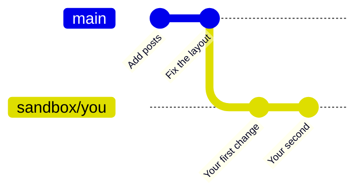

Everything from here happens on a branch of your own.

===
## What git is actually doing

[Git](https://git-scm.com/docs) records your project's history as a series of snapshots called **commits**.
Each one says: here is what changed, who changed it, and why.

A **branch** is a movable label pointing at one of those commits. `main` is the
branch everyone shares — it is meant to always work. When you start a piece of
work you make your own branch, which is just a second label starting from the
same commit. Your commits move your label forward; `main` stays where it is.



Nothing you commit on your branch can affect anyone else until it is merged.
That is the whole reason branches exist: you get to be wrong in private.

=== check=sandbox-branch,from-main
## Make yours

```bash
git switch main
git pull
git switch -c sandbox/your-name
```

Use your actual name — `sandbox/maria`, `sandbox/tom`. Three commands, three
jobs:

1. `git switch main` — start from the shared branch.
2. `git pull` — get everyone else's latest work, so you branch from current code.
3. `git switch -c <name>` — create a new branch and move onto it.

:::warn The prefix matters
Name it `sandbox/…`. This tutorial itself lives on a branch called `onboarding`,
and git will not let you have a branch called `onboarding` *and* a branch called
`onboarding/something` at the same time — a name cannot be both a file and a
folder.
:::

=== quiz=name-it,which-prefix
## Naming one properly

`sandbox/your-name` is fine for this tutorial, because the work is not real. On
a real branch the name is read by other people, in a list, without any of your
context. This is what a badly named repository looks like from outside:

```
patch-1
maria-work
new-stuff
test2
fix
```

Nobody can tell what any of those are, including the people who made them.

The convention here, and in most places:

```
type/issue-number-short-description
```

```
feature/204-product-search
fix/187-cart-total-with-discount
docs/91-api-route-examples
```

Three things a reader gets before opening anything: what kind of change it is,
which issue it belongs to, and roughly what it touches.

===
## The prefixes

| Prefix | For | Example |
|---|---|---|
| `feature/` | Something the app could not do before | `feature/204-product-search` |
| `fix/` | Something is broken and should not be | `fix/187-cart-total` |
| `refactor/` | Tidying. **Behaviour must not change** | `refactor/210-split-post-handler` |
| `docs/` | Documentation only, no code | `docs/91-testing-guide` |
| `test/` | Adding or repairing tests only | `test/215-product-edge-cases` |
| `chore/` | Dependencies, config, tooling | `chore/220-bump-next` |
| `style/` | Formatting only, no logic | `style/198-tidy-imports` |

The prefix is not decoration — it tells a reviewer what to look for. `refactor/`
says "the behaviour should be identical", so their job is to check that nothing
changed and that the existing tests still pass untouched. Call the same work
`feature/` and they will go looking for new behaviour that is not there.

:::note If two prefixes both fit, split the branch
A branch that is genuinely `fix/` **and** `feature/` is usually two pieces of
work that will be easier to review apart. That is the same instinct as the
commit rule: if you cannot describe it without "and", it is two things.
:::

===
## The rules underneath

**Lowercase, hyphens between words.** `fix/204-cart-total`, never
`Fix/204_Cart_Total`. Git allows capitals and spaces; every tool then makes you
quote the name, and on macOS and Windows `Fix/` and `fix/` are the same branch,
which produces genuinely baffling errors.

**Include the issue number when there is one.** GitHub links them up, and in six
months it is the fastest route from a line of code back to the conversation
about why.

**A few words, not a sentence.** `feature/204-product-search`, not
`feature/204-add-a-search-box-to-the-products-page-for-customers`. You will type
this.

**Say what it touches, not what you did.** `fix/187-cart-total` beats
`fix/187-my-changes`.

:::blank Finish these branch names
Issue #310, the login page rejects valid emails
   {{fix}}/310-login-email-validation

Issue #312, add a "recently viewed" list
   {{feature}}/312-recently-viewed

Issue #315, the README still says Node is not required
   {{docs}}/315-readme-node-requirement
:::

:::warn One name you cannot use
Do not start a branch with `onboarding/`. This tutorial lives on a branch
called `onboarding`, and git cannot have both a branch with that name and
branches beneath it — the same way a file and a folder cannot share a name.

That is why yours is `sandbox/`.
:::

===
## Commands you will use constantly

| Command | What it tells you |
|---|---|
| `git status` | What have I changed? What branch am I on? |
| `git branch` | What branches exist, and which am I on? |
| `git switch <name>` | Move to an existing branch. |
| `git switch -c <name>` | Create a branch and move to it. |
| `git log --oneline` | What has happened here recently? |

`git status` is the one to run whenever you are unsure. It is free, it changes
nothing, and it almost always answers your question. Run it now.

:::note "Detached HEAD" and other frights
Git error messages are famously alarming and almost never mean you have lost
work. Committed work in git is very hard to destroy. If you end up somewhere
confusing, `git status` usually tells you the way out, and asking someone is
faster than guessing.
:::
