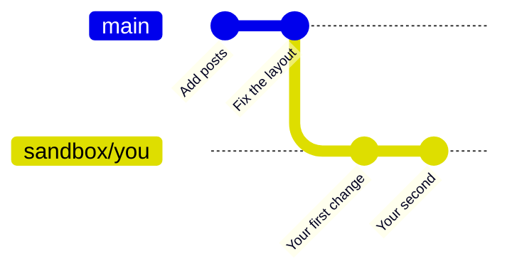
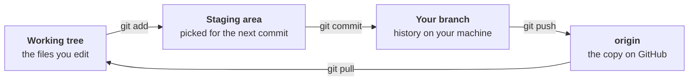

Everything from here happens on a branch of your own.

===
## What git is actually doing

[Git](https://git-scm.com/docs) records your project's history as a series of snapshots called **commits**.
Each one says: here is what changed, who changed it, and why.

A **branch** is a movable label pointing at one of those commits. `main` is the
branch everyone shares — it is meant to always work. When you start a piece of
work you make your own branch, which is just a second label starting from the
same commit. Your commits move your label forward; `main` stays where it is.



Nothing you commit on your branch can affect anyone else until it is merged.
That is the whole reason branches exist: you get to be wrong in private.

===
## The four places your work can be

A change you make travels through four places, and one command moves it between
each pair.



Almost every confusing moment with git is really the question **which of those
four is my work in right now** — and there is one command that always answers
it:

```bash
git status
```

Run it constantly. It is free, it changes nothing, and it tells you what is in
the working tree, what is staged, and whether your branch is ahead of or behind
`origin`.

:::why Why `origin` is a separate place, and not just a backup
`origin` is the name of the copy on GitHub. Your branch and `origin/main` are
two different histories that happen to be related.

That is why a commit is not on GitHub until you push, why other people's work is
not on your machine until you pull, and why `git log` can look completely
different on two laptops. Nothing is shared automatically. Every move across
that last arrow is one you make on purpose.
:::

=== check=sandbox-branch,from-main
## Make yours

```bash
git switch main
git pull
git switch -c sandbox/your-name
```

Use your actual name — `sandbox/maria`, `sandbox/tom`. Three commands, three
jobs:

1. `git switch main` — start from the shared branch.
2. `git pull` — get everyone else's latest work, so you branch from current code.
3. `git switch -c <name>` — create a new branch and move onto it.

:::warn The prefix matters
Name it `sandbox/…`. This tutorial itself lives on a branch called `onboarding`,
and git will not let you have a branch called `onboarding` *and* a branch called
`onboarding/something` at the same time — a name cannot be both a file and a
folder.
:::

=== quiz=name-it
## Naming one properly

`sandbox/your-name` is fine here, because the work is not real. On a real branch
the name is read by other people, in a list, with none of your context:

```
patch-1        maria-work        new-stuff        test2
```

Nobody can tell what any of those are, including the people who made them. The
convention:

```
type/issue-number-short-description

feature/204-product-search
fix/187-cart-total-with-discount
```

What kind of change, which issue, roughly what it touches — before opening
anything. The prefix is what tells a reviewer what to look for: `refactor/`
means "check that nothing changed".

**The full list of prefixes is in the handbook**, in the sidebar. It is there
when you need it — do not memorise it.

===
## Commands you will use constantly

| Command | What it tells you |
|---|---|
| `git status` | What have I changed? What branch am I on? |
| `git branch` | What branches exist, and which am I on? |
| `git switch <name>` | Move to an existing branch. |
| `git switch -c <name>` | Create a branch and move to it. |
| `git log --oneline` | What has happened here recently? |

`git status` is the one to run whenever you are unsure. Run it now.

:::note "Detached HEAD" and other frights
Git error messages are famously alarming and almost never mean you have lost
work. Committed work in git is very hard to destroy. If you end up somewhere
confusing, `git status` usually tells you the way out, and asking someone is
faster than guessing.
:::
