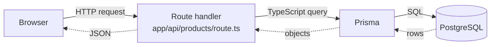

The API has to get its products from somewhere, and that somewhere is a
**database**.

## A database is a very careful spreadsheet

If you have used a spreadsheet, you already have the idea.

A database holds **tables**. A table has **columns**, which are the kinds of
information, and **rows**, which are the actual things.

| id | name | priceCents | description |
|---|---|---|---|
| `0199…a1` | Mug | 899 | Holds tea |
| `0199…b2` | Notebook | 450 | *(nothing)* |
| `0199…c3` | Pen | 199 | Writes |

Three products, four columns. Each row is one product; each column is one fact
that every product has.

Every column has a **type** — `name` holds text, `priceCents` holds a whole
number — and the database enforces it. Try to save the word "banana" as a price
and it refuses. That refusal is a feature: it is one class of bug that can never
reach your data.

## Why not just a file?

You could write products into a text file and read it back. It works fine until
it doesn't:

- **Two people at once.** Two customers buy the last mug at the same moment.
  With a file, both read "1 left", both write "0 left", and you have sold
  something twice. A database is built for exactly this.
- **Finding things.** To find one product in a file you read the whole file. A
  database finds one row among millions without touching the rest.
- **Half-finished writes.** If the power cuts out mid-write, a file is left
  corrupt. A database change either happens completely or not at all.

That last idea is worth the name: a **transaction**. Several changes that
succeed together or fail together, with nothing in between. Taking money from
one account and adding it to another is the classic case — you never want one
half without the other.

## Talking to it

Databases speak **SQL**:

```sql
SELECT * FROM "Product" ORDER BY "createdAt" DESC;
```

You will not write much SQL here. This project uses a tool called **Prisma**
that lets you write the same query in TypeScript:

```typescript
await db.orm.public.Product.orderBy((product) => product.createdAt.desc()).all();
```

Prisma turns that into the SQL above. The reason for the layer is not that SQL
is bad — it is that Prisma knows what your tables look like, so your editor
autocompletes every column and a typo like `product.creatd` is an error before
you run anything. With raw SQL, a misspelled column is a bug you find in
production.

## How this project fits together



Four layers, each translating for the next. **PostgreSQL** — usually just
"Postgres" — is the database this project uses. It runs in a container on your
machine, which you will start in the next step.

:::note One more idea, for later
The tables are not created by hand here. One file, `lib/prisma/contract.ts`,
describes what a `Product` is, and Postgres and TypeScript both get built from
it. You will edit that file yourself in step 12 — it is mentioned now only so
the word "contract" is not a surprise when it appears.
:::
