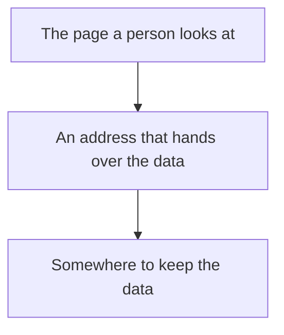

Before you build anything bigger, one skill: **taking a job that is too big to
start and cutting it into pieces that are obvious.**

You already did this once without noticing. Start there.

===
## The one you already did

In step 5 you added a tagline to the home page. Written out, that job was:

1. Switch to your branch
2. Open `app/page.tsx`
3. Add the paragraph
4. Look at the browser to check it worked
5. Commit it

Five small things, each one you could finish and be sure about. You did not plan
it, because it was small enough to hold in your head.

The whole skill is doing that deliberately when the job is *not* small enough to
hold in your head.

:::why Why bother writing it down
Three things it buys you, and only the first is obvious:

- **You always know what to do next.** Sitting down tomorrow, the list tells you
  where you were.
- **You find out what you misunderstood while it is still cheap.** Writing down
  "stop two products having the same name" makes you ask whether names have to
  be unique — thirty seconds now, half a day after the code exists.
- **You get to finish things.** Ticking off six small tasks feels completely
  different from being 30% through one big one, and it shows in how much you get
  done.
:::

===
## What order?

Some tasks have to come before others. Here are those five, jumbled. Put them
back.

:::order Put these back in a sensible order
Switch to your branch
Open app/page.tsx
Add the paragraph
Look at the browser to check it worked
Commit it
:::

You cannot check it in the browser before you have written it, and you should
not commit before you have checked.

**That is all ordering is: each task needs the ones above it to be done already.**

===
## Now a bigger one

Here is the next job:

> Zizzu needs products. People should be able to see what is for sale and add
> new items.

Too big to start. But the cut is easier than it looks, because almost every web
feature is the same three layers:



Read each arrow as "needs". The page needs the address. The address needs
somewhere to read from.

So you build them **bottom to top**: storage first, then the address, then the
page. Do it the other way and you spend the day building against things that do
not exist yet, with no way to tell whether any of it works.

===
## Cut each layer up

One task should be one thing you could finish, check, and commit — and describe
in a sentence without using the word "and".

Take the middle layer, "an address that hands over the data". That is really two
jobs, because reading and writing are different:

- getting the list of products *out*
- putting a new product *in*

And each of those needs somebody to check it works, which is another task each.

:::note The test for a good task
After you finish it, is the project still working?

"Make the database able to store a product" passes: the table exists, nothing is
broken. "Do half the checking" does not. A task that leaves the project broken
in the middle was cut in the wrong place.
:::

=== check=sandbox-branch,plan-exists,plan-tasks,plan-ordered
## Write your list

Make sure you are on your sandbox branch, then create a file called `PLAN.md` at
the top of the project.

Here is the start of it. **Copy this in, then add your own tasks underneath** —
five or more in total.

```markdown
# Products

**Done when:** anyone can see the products at /products and can add a new one.

- [ ] Make the database able to store a product
- [ ] Make an address that hands back the list of products
- [ ] Check that it really does
```

To keep going, ask yourself:

- What is still missing before someone can *add* a product?
- What should happen if someone types a price of `-5`? Is dealing with that a task?
- What about the page itself?
- How does anyone know each piece works?

:::note You do not need the right words
Write it in whatever language you have. "Make somewhere to keep products" is
every bit as good as the same thing said in jargon you have not been taught yet.
Nobody is marking the vocabulary.
:::

=== quiz=too-big,why-decompose
## Compare

One reasonable version:

```markdown
# Products

**Done when:** anyone can see the products at /products and can add a new one.

- [ ] Make the database able to store a product
- [ ] Make an address that hands back the list of products
- [ ] Check that it really does
- [ ] Make an address that accepts a new product
- [ ] Check that it really saves one
- [ ] Refuse bad input — no name, silly price
- [ ] Refuse a product whose name is already taken
- [ ] Build the /products page showing the list
- [ ] Add the form for adding one
- [ ] Check the whole thing in a browser
```

Yours will not match, and does not need to. What is worth noticing:

- **Storage is first.** Everything else needs it.
- **Reading and writing are separate.** Different jobs, different checks.
- **Refusing bad input is its own task.** Because it is on the list, it will get
  done. Things not on the list get found by somebody else, later.
- **Checking is half the lines**, sitting next to the thing being checked —
  not saved up for the end.

Compare the two and ask what each of you spotted that the other did not. That
comparison *is* the exercise.

:::try
Commit your plan:

```bash
git add PLAN.md
git commit -m "Add a plan for products"
```

You will tick these off as you go. In real work this list lives in the issue,
where the team can see it — that comes in step 18.
:::
