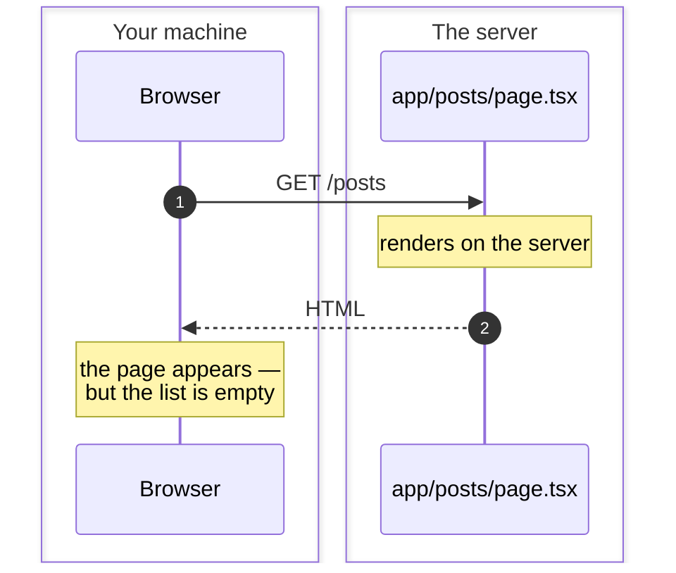
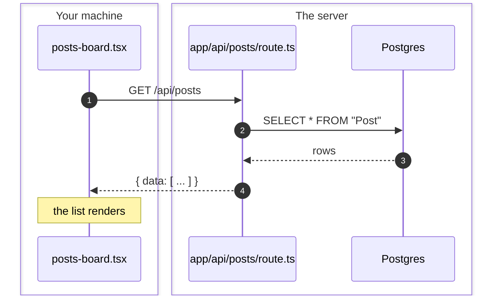
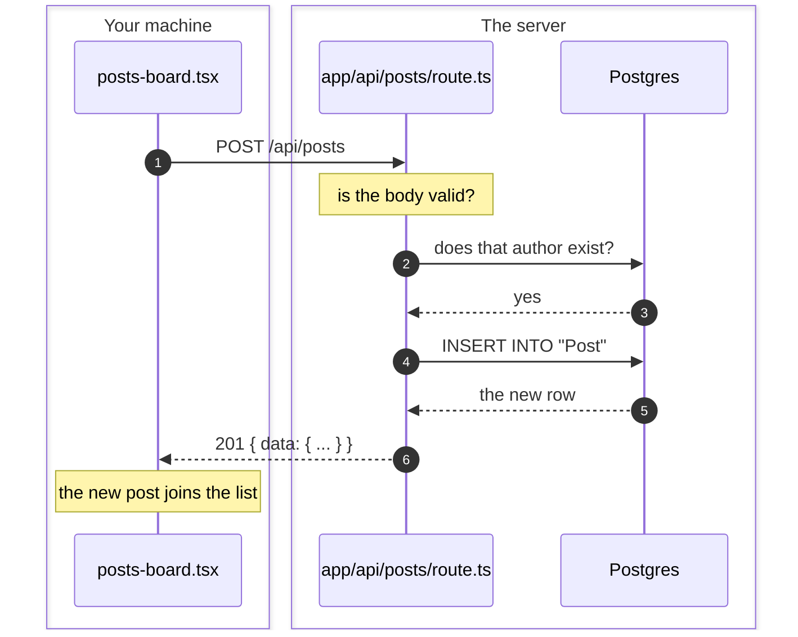

You have changed something you can see. Before building something new, here is
what happens between a person clicking a button and a row landing in the
database.

Everything below is really happening on your machine right now, at
[localhost:3000/posts](http://localhost:3000/posts). Open it in one tab and read
this in the other.

## The trip, in three parts

The whole journey is a lot at once, so here it is in the three things that
actually happen. Watch which side of the line each participant sits on — that
is the distinction you proved for yourself in the last step.

### 1. The page arrives

### 2. The list fills in

`posts-board.tsx` is now running **in your browser**, so it has to ask the
server for data.

### 3. You create a post

Two round trips to show a list, and a third to add to it. Every arrow crossing
the line between the boxes is an HTTP request — the same kind you made by hand
with `curl` two steps ago.

Four files, and each has one job:

| File | Job |
|---|---|
| `app/posts/page.tsx` | The page's structure. Runs on the server. |
| `app/posts/posts-board.tsx` | The interactive part. Runs in the browser. |
| [`app/api/posts/route.ts`](https://nextjs.org/docs/app/api-reference/file-conventions/route) | Answers HTTP requests. Runs on the server. |
| `lib/prisma/contract.ts` | Says what a `Post` is. |

## Server and browser are different worlds

This is the idea that makes Next.js confusing until it clicks.

**By default, components run on the server.** They execute once, produce HTML,
and that HTML is sent to the browser. The component's code never reaches the
user. It can read files, hold secrets, and query the database directly.

**A component marked `'use client'` also runs in the browser.** That is what
`app/posts/posts-board.tsx` does, on its very first line. It has to: it uses
`useState` and `useEffect` and responds to a form submission, and none of that
exists on a server that finished its work milliseconds ago.

The catch is what a Client Component *loses*. Its code is shipped to the user's
browser, so it cannot hold a database password, and it has no direct line to
Postgres. If it needs data, it has to ask the server over HTTP.

That is the entire reason `/api/posts` exists.

:::note So when do you need a Route Handler?
Only when data has to move **after** the page has loaded. A page that just
displays things is better as a Server Component querying the database directly —
one round trip instead of two, and less code.

`posts-board.tsx` needs one because the list changes when the user submits the
form, long after the server has moved on.
:::

## What the endpoint does

Open `app/api/posts/route.ts` and read the `POST` function. Ignore the details;
notice the shape:

1. Try to parse the body as JSON. If that fails → **400**.
2. Validate the fields. Missing title, title too long, author id not a UUID → **400**.
3. Check the author actually exists → if not, **422**.
4. Create the row → **201**, with the new post.
5. Anything unexpected → log it on the server, answer **500** with a generic message.

Five outcomes, and only one of them is the happy path. That ratio is normal, and
it is most of why endpoints are longer than you would expect.

Those are the status codes from step 7, doing their job: the 422 is "I
understood you, but that author does not exist", which is a different problem
from the 400s above it and deserves a different answer.

:::warn Never let an error leak
Look at `internalError` at the bottom of the file. It logs the real error where
the team can see it, and sends the caller a flat message. A raw database error
sent to a browser can contain table names, queries, sometimes connection
strings. Log the detail, return the summary.
:::

## One shape for every response

Every handler in this project answers `{ data }` or `{ error }`. Never a bare
array, never a different field name.

That is a convention, not a rule Next.js enforces — and conventions are what let
a codebase stay readable as it grows. Anyone can consume any endpoint here
without reading it first, and your new endpoint will be no exception.

Four questions before you build one.
