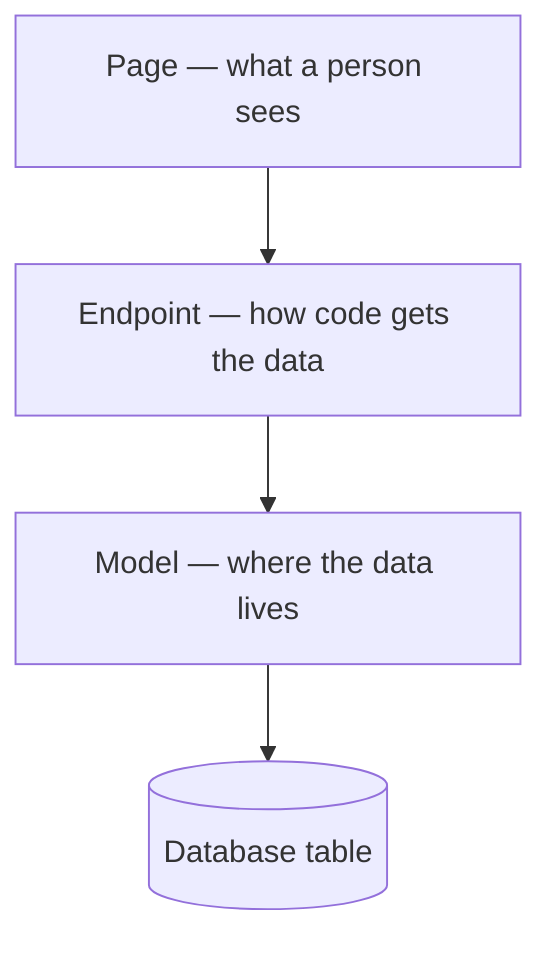

Here is the job:

> Zizzu needs products. People should be able to see what is for sale and add
> new items.

Two sentences. Somewhere between here and there is a week of decisions, and if
you open your editor now you will make them one at a time, in whatever order
they happen to occur to you.

So do not open your editor. The skill this step is teaching is the one that
separates people who finish from people who thrash: **breaking a job into pieces
small enough to be obvious.**

## Why it works

A big task is frightening because you cannot hold it in your head. A small task
is not frightening because you can see both ends of it.

Decomposing buys three specific things:

- **You find out what you misunderstood while it is still cheap.** Writing down
  "reject a duplicate name" forces you to ask whether names have to be unique —
  a question that costs thirty seconds now and half a day after the code exists.
- **You always know what to do next.** Sitting down tomorrow, the list tells you
  where you were. This matters more than it sounds.
- **You get to finish things.** Ticking off six small tasks in a day feels
  entirely different from being 30% through one large one, and the difference
  shows up in how much you get done.

## How to do it

**1. Say what "done" means, in one sentence.** If you cannot, you do not
understand the job yet, and that is the thing to fix first.

**2. Find the layers.** Almost every web feature is the same stack, and each
layer needs the one below it:



**3. Work bottom-up.** Build the model, then the endpoint, then the page. Do it
the other way and you spend the day building against things that do not exist
yet, unable to check that any of it works.

**4. Split each layer until each piece is one sitting's work.** A task is the
right size when you could finish it, test it, and commit it — and describe it in
a sentence without using the word "and".

:::note The test for a good task
After you finish it, is the project still working?

"Add the Product model" passes: the table exists, nothing is broken. "Add half
the validation" does not. Tasks that leave the project broken in the middle are
tasks that were cut in the wrong place.
:::

## Your turn

Make sure you are on your sandbox branch, then create a file called `PLAN.md` at
the top of the project. Write out the products job as a checklist.

Markdown checkboxes look like this, and GitHub renders them as real tick-boxes
in an issue:

```markdown
# Products

**Done when:** anyone can see the products list at /products and add a new one.

## Tasks

- [ ] Add a `Product` model to the contract and regenerate
- [ ] ...
```

Write your own list before reading any further. Aim for at least five tasks, in
the order you would do them. Think about:

- What has to exist before anything else can work?
- Reading and writing are two different jobs — should they be one task?
- What happens when someone sends a price of `-5`? Is that a task?
- How does anyone know each piece works?

:::warn Write yours first
There is a worked answer below. It is worth much less to you if you read it
before making your own attempt — the useful part is noticing the difference
between the two lists.
:::

---

## One reasonable answer

```markdown
# Products

**Done when:** anyone can see the products list at /products and add a new one.

## Tasks

- [ ] Add a `Product` model to the contract, regenerate, create the table
- [ ] Write a failing test for `GET /api/products`
- [ ] Make it pass
- [ ] Write a failing test for `POST /api/products` creating a product
- [ ] Make it pass
- [ ] Reject invalid input with 400 (missing name, bad price)
- [ ] Reject a duplicate name with 422
- [ ] Add the /products page listing products
- [ ] Add the create form to the page
- [ ] Add a browser test for the happy path
```

Ten tasks. Notice what it does:

- **The model is first.** Everything else needs it.
- **Read and write are separate.** Both are endpoints on the same file, but they
  are different jobs and different tests, and doing them separately means each
  one is finished before the next begins.
- **Validation is its own task, not an afterthought.** Because it was on the
  list, it will get done. Things that are not on the list get discovered at
  review.
- **Every task leaves the project working.** You could stop after any line and
  the app still runs.
- **Tests are not a task at the end.** They are half the lines, sitting next to
  the thing they test.

Your list will not match this one, and does not need to. Compare them and ask
what each of you noticed that the other did not — that comparison *is* the
exercise.

:::try
Save your `PLAN.md`, then commit it:

```bash
git add PLAN.md
git commit -m "Add a plan for the products feature"
```

You will tick these off as you go. In real work this list lives in the GitHub
issue instead, where the rest of the team can see it — you will meet that in
step 19.
:::
