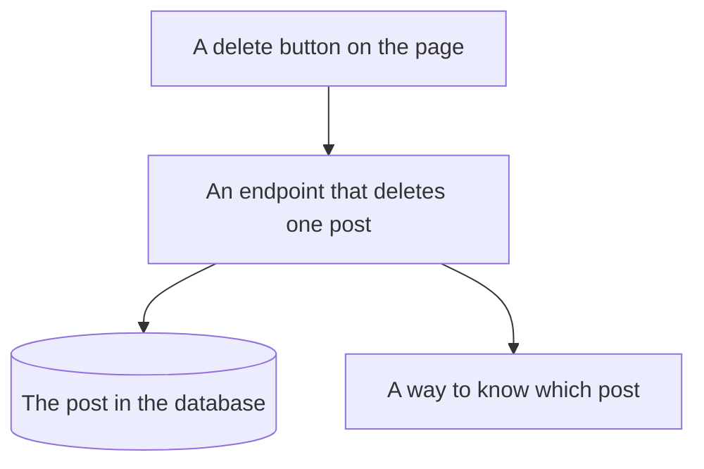

Here is a job somebody might hand you on a Monday:

> Let people delete their own posts.

One sentence. Small, even. And there is still no obvious first line to type.

This step is the skill that fixes that — and it is a skill, not a personality
trait. People who are good at it are running a procedure you can learn in half
an hour.

===
## Two questions, not one

"Break it down" gets used for two different things, and mixing them up is the
commonest way a plan goes wrong.

**What needs what?** The page cannot read from an endpoint that does not exist.
The endpoint cannot read from a table that does not exist. That is a *fact about
the code* — you do not get a say in it.

**What order will I work in?** That is a *choice about your week*.

They are related — what needs what rules out some orders — but they are not the
same, and the first one has to be settled before the second is even a question.

So: dependencies first, always. Order second.

=== quiz=two-questions
## What needs what

Take the delete job. Ask of each piece: *what has to already exist for this to
work at all?*



Read every arrow as **needs**. The button needs the endpoint. The endpoint needs
the post to exist, and needs to be told which one.

Nothing about time yet. This diagram would be identical if you built it over a
year or an afternoon.

===
## Then turn it into an order

Now the arrows have something to say about time: **build the bottom before the
top.** Anything with an arrow pointing at it has to exist first.

For the delete job that gives:

1. The endpoint that deletes one post
2. Something that proves it works
3. The button on the page that calls it

Note what dependency did *not* decide: whether you write the test before or
after the endpoint, or whether the button gets styled today or tomorrow. Those
are yours. Dependency narrows the possible orders; it does not pick one.

===
## Trace it before you trust it

Here is the part almost nobody does, and it takes two minutes.

**Walk your list in order and ask, after each line: what actually exists now?**

Try it on this plan for the delete job. Somebody wrote it in a hurry.

```markdown
- [ ] Add a delete button to the post
- [ ] Add the DELETE endpoint
- [ ] Test it
```

Line 1: a button exists. Clicking it does nothing, because there is nothing to
call. **The project now looks finished and is not** — the worst state to leave
anything in, because the next person believes the button.

Line 2: the endpoint exists. Nothing about "which post", so it either deletes
the wrong one or cannot run at all.

Line 3: "test it" — test what? This is one line covering three behaviours, and
it will get done last, badly, or not at all.

And one thing the trace finds that reading never does: **what happens when the
post is not there?** Nobody wrote it down, so nobody will build it, and it will
be found by a reviewer or a user.

=== quiz=trace-it
## The two things tracing catches

**A step that needs something not built yet.** The button before the endpoint.
Obvious in hindsight, invisible while you are writing the list.

**A piece nobody remembered.** The missing case, the error state, the empty
list. These are not oversights of skill — they are things that only occur to you
when you walk the path rather than describe it.

Here is the same plan after a trace:

```markdown
- [ ] Add a DELETE endpoint that removes one post by id
- [ ] Prove it deletes the right one
- [ ] Answer 404 when the post does not exist
- [ ] Add the button, wired to the endpoint
- [ ] Remove the post from the list on screen once it succeeds
```

Five lines instead of three, and every one of them can be finished, proved, and
committed on its own.

===
## How small is small enough

One task is one thing you could finish, prove, and commit — and describe in a
sentence without the word "and".

:::note How to tell a task is the right size
Ask: after I finish it, is the project still working?

"Add a DELETE endpoint" passes — the endpoint exists, nothing is broken, the
button is not there yet and nothing pretends it is. "Add half the validation"
does not. A task that leaves the project broken in the middle was cut in the
wrong place.
:::

Two failure modes, and you will have one of them:

**Too big.** "Build the delete feature." You cannot start it and you cannot
finish it, so you work for a day and have nothing to tick.

**Too small.** "Import the db client." That is not a unit of anything. If your
list has thirty items and none of them is worth a commit, you are writing
instructions to yourself, not a plan.

=== check=sandbox-branch,plan-exists,plan-tasks,plan-ordered ask=why-storage-first
## Your turn, on the real job

Now the one you are actually about to build:

> Zizzu needs products. People should be able to see what is for sale and add
> new items.

Make sure you are on your sandbox branch, then create `PLAN.md` at the top of
the project.

**Do it in the order this step gave you.**

1. **What needs what?** Sketch it — on paper is fine. What has to exist before a
   person can see a product? Before they can add one?
2. **Turn it into a list**, bottom of the stack first.
3. **Trace it.** Walk your own list and ask after each line what exists now.
   Fix what that finds — it will find something.

```markdown
# Products

**Done when:** anyone can see the products at /products and can add a new one.

- [ ] ...
```

Five or more tasks. Questions worth asking while you trace:

- Where does a product live before anyone can read one back?
- Reading and writing are different jobs. Are they one task or two?
- What should happen if someone types a price of `-5`? Whose task is that?
- How would anyone know each piece works?

:::note Words you have not met yet
Write it in whatever language you have. "Make somewhere to keep products" is
every bit as good as the same thing in jargon you have not been taught. Nobody
is marking the vocabulary.
:::

=== ask=plan-review
## Get a second opinion on it

The checks above can count your tasks and catch a page built before the thing it
reads from. What they cannot tell you is whether a task is really *one* task, or
whether you have missed a piece — and that is most of what makes a breakdown
good or bad.

So paste your list below and get a read on it.

This will not stop you continuing whatever it says, and it is not marking you.
It is doing what you would get from leaning over to the person next to you and
asking "does this look about right?" — which, on a real team, is what you should
do with your first few plans anyway.

:::note If it disagrees with you
It is a second opinion, not a verdict, and it has not seen the codebase. Where
it and your list differ, the interesting move is to work out which of you is
right — and if it is you, you have just discovered you can defend your plan,
which is the more useful outcome.
:::
