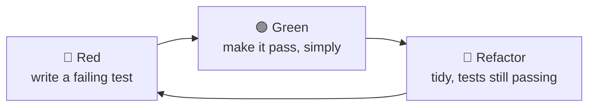

There is a table. There is no endpoint. The obvious next move is to write the
endpoint — and you are going to do the opposite.

===
## Write the test first

Test-driven development is three steps, repeated:

1. **Red.** Write a test for something that does not exist. Run it. Watch it
   fail.
2. **Green.** Write the simplest code that makes it pass.
3. **Refactor.** Tidy up, with the test there to catch you.



The step people skip is the first one, and it is the one that does the work.

:::why Why write the test first, when you could just write the code?
A test you have never seen fail proves nothing. If you write the code first and
then a test that passes, you have learned exactly one thing: the test passed
once. You do not know whether it would notice if the code broke — and a test
that cannot fail is worse than no test, because it looks like coverage.

Watching it go red first is the only way to know it is wired up to anything.

There is a second effect, which you will notice within the hour: writing the
test first forces you to decide what the endpoint should *do* before you are
elbow-deep in how it works. You end up designing the thing from the outside,
which is where it is actually used.
:::

===
## What a test looks like here

A Route Handler is just a function — it takes a request, returns a response. So
a test builds a request, calls the function, and looks at what comes back. No
server involved.

Every test follows the same three beats:

```typescript
it('does the thing', async () => {
  // 1. arrange — set up what this test needs
  const author = await createUser();

  // 2. act — do the one thing being tested
  const response = await POST(postRequest('/api/posts', { title: 'Hello', authorId: author.id }));

  // 3. assert — check what happened
  expect(response.status).toBe(201);
});
```

Arrange, act, assert. In that order, every time. When a test is hard to read, it
is usually because those three have been shuffled together.

The test runner is [Vitest](https://vitest.dev/), and `describe`, `it` and
`expect` are available without importing them.

Two things are given to you:

- **`test/helpers.ts`** — `createUser()`, `createPost()`. They put rows in the
  database so your test does not read as database plumbing.
- **`test/request.ts`** — `getRequest(path)`, `postRequest(path, body)`. They
  build the request object.

And one thing happens invisibly: **every test starts with empty tables.** You
never clean up after yourself, and no test can be affected by one that ran
before it.

=== check=sandbox-branch,test-exists,no-route-yet
## Your test

Create `__tests__/api/products.test.ts` with one test: `GET /api/products`
returns an empty list when there are no products.

```typescript
import { GET } from '@/app/api/products/route';
import { getRequest } from '@/test/request';

describe('GET /api/products', () => {
  it('returns an empty list when there are no products', async () => {
    const response = await GET(getRequest('/api/products'));

    expect(response.status).toBe(200);
    expect(await response.json()).toEqual({ data: [] });
  });
});
```

Yes, it imports a file that does not exist. That is the point.

:::note What `@/` means
A shortcut for the project root, set up in `tsconfig.json`. `@/test/request`
means `test/request` from the top of the project — so a file can move between
folders without every import in it breaking.
:::

=== check=red,test-committed
## Run it and read the failure

```bash
npm test -- __tests__/api/products.test.ts
```

It fails — something like `Failed to resolve import "@/app/api/products/route"`.

Read it properly. It is not saying "you did something wrong"; it is saying "the
thing you asked for is not there yet", which is precisely what you expected.
Getting comfortable reading failure output is most of what separates a fast
developer from a stuck one.

:::try
Write the test, run it, watch it fail, then **commit it on its own**.

Committing a failing test feels wrong. It is not: the commit is a statement of
what the code should do, and the next commit makes it true. The check below
looks for exactly that pair, in that order.

Something like: `Add a failing test for GET /api/products`
:::
