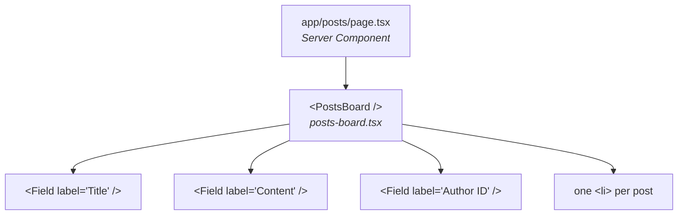

You have edited three `.tsx` files now, and nobody has told you what the things
in them are called.

That stops here. Everything below is in `app/posts/posts-board.tsx` and
`app/page.tsx` — the two files you already have open.

===
## A component is a function that returns markup

Open `app/posts/posts-board.tsx` and scroll to the bottom. `Field` is the whole
idea in twenty lines:

```tsx
function Field({ label, name, required, placeholder }: {
  label: string;
  name: string;
  required?: boolean;
  placeholder?: string;
}) {
  return (
    <label className="flex flex-col gap-1 text-sm">
      <span>{label}</span>
      <input name={name} required={required} placeholder={placeholder} />
    </label>
  );
}
```

That is it. A function. It returns markup instead of a number.

**The capital letter is not style.** React uses it to tell your components from
the browser's tags: `<Field />` is yours, `<input />` is the browser's. Write
`<field />` and React looks for an HTML element called `field`, finds nothing,
and renders nothing — with no error.

===
## Props are its arguments

Scroll up in the same file. `Field` is called three times:

```tsx
<Field label="Title" name="title" required />
<Field label="Content" name="content" />
<Field label="Author ID" name="authorId" required placeholder="UUID of an existing user" />
```

Each of those is a function call. `label="Title"` sets the `label` parameter.
`required` on its own means `required={true}`.

The type block right after the parameters lists which props exist and which are
optional — that is the `?` from {{step:typescript}}, doing the same job here.

Three calls, one definition, three inputs that cannot drift apart. That is why
you write a component instead of copying the `<label>` block three times.

:::note You have already seen one from a library
`app/page.tsx` has this near the top:

```tsx
<Image src="/next.svg" alt="Next.js logo" width={100} height={20} priority />
```

Capitalised, so it is a component. `src` and `alt` are props. `width={100}` is a
prop whose value is a number rather than text — which needs braces, because
`width="100"` would be the string.

That is the same `{ }` rule from {{step:first-change}}, now in the attribute
position: **braces mean the next thing is JavaScript**, wherever they appear.
:::

===
## How the two files fit together

{{step:two-machines}} had you put a log in each of these and watch them print in
different places. Here is the part that step did not say: one of them renders
the other.



A page is a tree of components, each one a function call whose result gets
placed inside the one above it. `page.tsx` is short because almost everything it
does is say *put the board here*.

===
## Two more things you will read constantly

**Conditional rendering.** There is no `if` inside markup, so a condition is an
expression that produces either something or nothing:

```tsx
{createState.error ? <p role="alert">{createState.error}</p> : null}
```

`null` renders nothing at all.

Further down the same file is a longer version — `loadError ? … : posts === null
? … : posts.length === 0 ? … : …`. That is **four states of one list**, in
order: failed, still loading, loaded but empty, loaded with things in it.

Every list you ever build needs all four, and the empty one is the one people
forget.

**Lists and `key`.** To render many things you map over an array:

```tsx
{posts.map((post) => <li key={post.id}>{post.title}</li>)}
```

`key` is how React tells one item from another between renders. Give it
something stable and unique — a database id. **Not the array index**, which
changes the moment anything is inserted or removed, so React matches up the
wrong rows.

=== check=sandbox-branch,tagline-component,tagline-rendered,tagline-served
## Now write one

You have read four components. Write one.

Take the tagline you added to the home page in {{step:first-change}} and move it
into a component of its own.

**1.** Create `app/tagline.tsx` — kebab-case filename, PascalCase component, the
rule from {{step:naming}} with something real to attach to at last:

```tsx
export function Tagline({ text }: { text: string }) {
  // return the <p> you wrote, with {text} where your words were
}
```

**2.** In `app/page.tsx`, import it and render it where the paragraph used to
be:

```tsx
import { Tagline } from './tagline';
```

```tsx
<Tagline text="Everything you need, and some things you don't." />
```

**3.** Reload. **The page should look exactly as it did before.**

That is the whole test. You have changed how the page is built and not what it
shows — which is what almost every refactor is, and why the tests you write in
week two are worth having.

:::note Why a named export here, and a default one in `page.tsx`
`page.tsx` and `route.ts` are found by Next.js *by their position in the
folders*, so it needs a single obvious thing to pick up: the default export.

Everything else is a named export, so the import has to say what it wants —
`import { Tagline }` — and your editor can find it, rename it, and tell you when
it is gone. Match the file next to you and you will get this right without
thinking about it.
:::

:::try
Commit it on its own. `Move the tagline into its own component` is a good
subject line: it says what changed, and a reviewer reading it knows to check
that nothing looks different.
:::

=== check=highlights-list,highlights-empty,highlights-rendered
## Now one that renders a list

`Tagline` shows one thing. Most components show *many* — and that is where the
two ideas from the last card meet.

Create `app/highlights.tsx`. It takes an array of strings and renders them as a
list:

```tsx
export function Highlights({ items }: { items: string[] }) {
  // if there are none, render nothing
  // otherwise a <ul> with one <li> per item
}
```

Then put it on the home page under your tagline, with a couple of real ones:

```tsx
<Highlights items={['Free returns', 'Next-day delivery']} />
```

Three things this exercise is actually about, and all three are checked:

**The array is JavaScript**, so the prop needs braces — `items={[...]}`, not
`items="..."`. Same rule as `width={100}`.

**Every `<li>` needs a `key`.** Use the text itself: `key={item}`. Not the array
position — that changes when anything is inserted, and React starts matching up
the wrong rows.

**Decide what an empty list does.** Passing `items={[]}` should render nothing at
all, not an empty box with a gap where a list would be. Either return `null`
early, or put the condition in the markup — both are normal.

:::note You will meet all three again
The board you fix in {{step:ui}} has a missing `key` in it, and it is one of
three bugs you have to find without being told where. Having written one
yourself is the difference between spotting it and reading about it.
:::

:::try Prove the empty case
Change the prop to `items={[]}`, reload, and check the page has no stray
whitespace where the list was. Then put your items back.
:::

===
## What you can now read

Go back to `posts-board.tsx` and read it top to bottom. You will not follow all
of it — `useActionState` and the form handling are a mechanism you do not need
yet, and `docs/` has them when you do.

But you can now name most of what you see: a component, its props, the markup it
returns, the conditions deciding what shows, and the list being mapped over.

One thing in it is still unexplained, and it is the line that decides where the
whole file runs. That is the next step.
