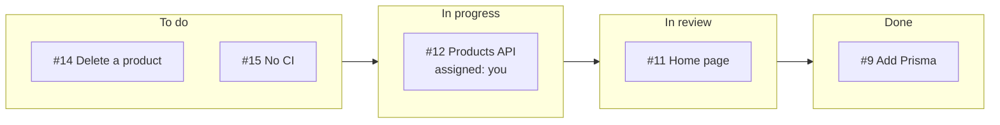

You have built a feature. On a real team you would not have started until the
work was written down and claimed, so let us do that part properly now.

## Issues

An **issue** is one piece of work: a bug, a feature, a question. It has a title,
a description, and a conversation attached to it.

The reason issues exist is not bureaucracy. It is that the alternative — work
living in someone's head, or in a message thread — means two people build the
same thing, or nobody builds it, and six months later nobody can remember why a
decision was made.

The issue is where the *why* lives. The code only ever shows the *what*.

## The board

The **project board** is every issue as a card in a column:



One glance answers: what is being worked on, by whom, and what is waiting for
someone. That is its entire job.

**Moving your card is not admin — it is how you communicate.** A card sitting in
"To do" that you have been working on all week means someone else may pick it
up, and your standup update is wrong before you have given it.

## Claiming work

1. Find an issue in **To do** that is not assigned to anyone.
2. Read it properly. All of it, including the comments.
3. Assign it to yourself. That is the flag that says *this one is taken*.
4. Move it to **In progress**.
5. Comment with how you plan to approach it — one or two sentences.

That last one feels unnecessary and is the most valuable. If you have misread
the issue, this is where you find out, at a cost of thirty seconds. The
alternative is finding out in review, after two days of work.

> Going to add a `Product` model and a `GET`/`POST /api/products` following the
> pattern in `posts`. Shout if the price should be decimal rather than cents.

## Branch names

Name your branch after the work, and mention the issue number:

```
feature/12-product-api
fix/31-empty-cart-crash
```

Then anyone looking at your branch knows what it is for and where the discussion
is. (For this tutorial you are on `sandbox/your-name` — real work gets a real
name.)

## Asking for help

You will get stuck. Everyone does, every week. The only mistake is being stuck
silently.

A useful question has three parts:

> **What I expected:** `POST /api/products` to answer 201.
> **What happened:** 500, and the log says `column "price_cents" does not exist`.
> **What I tried:** re-ran `contract emit`, restarted the app container.

That shape does two things. It proves you did the work, and it lets someone
answer in one reply instead of five. Rough rule: **two hours stuck is enough.**
Nobody is impressed by a silent week.

:::note About the word "junior"
Asking questions is not a phase you grow out of. Senior developers ask more
questions, not fewer — they have just learned which ones are worth asking, and
that not knowing something is a fact rather than a confession.
:::
