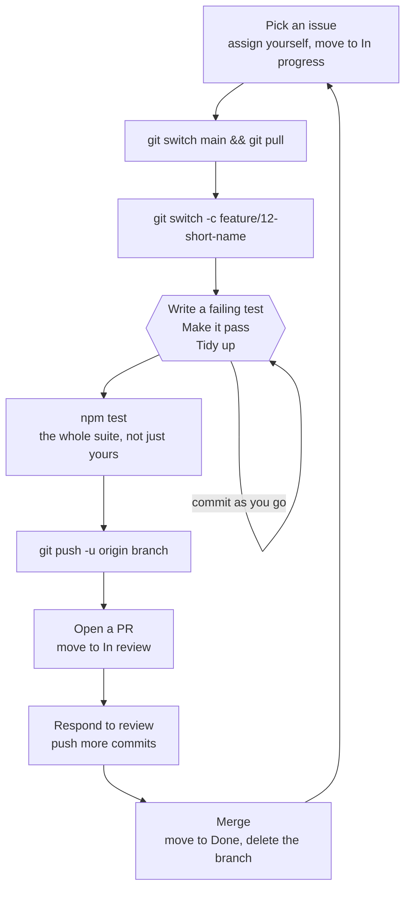

Last step. Close the loop, put the repository back how you found it, and take
the cheat sheet with you.

=== check=back-on-main,main-untouched attest=closed,issue-done
## Finish up

1. **Close your pull request without merging it.** On the PR page: "Close pull
   request", below the comment box.
2. **Move your issue to Done** on the board.
3. **Delete the scratch files you made along the way.** `PLAN.md` was your
   working notes — on a real branch that list lives in the issue, not in the
   repository:

```bash
git rm PLAN.md
git commit -m "Remove the working plan"
```

   `lib/products.ts` and its tests you keep. That is real, tested code.

4. **Go back to `main`:**

```bash
git switch main
```

Your branch still exists, and so do all your commits — closing a PR does not
delete anything. If you want it gone:

```bash
git branch -D sandbox/your-name
git push origin --delete sandbox/your-name
```

Deleting a merged branch is normal housekeeping on a real project. The work is
in `main`; the label is just clutter.

---

===
## The loop, from here on

Every piece of work you do looks like this:



===
## Commands

**Every day**

```bash
./script/server                  # start the containers
docker compose watch             # sync your edits into the app container
docker compose logs -f app       # what is the server actually saying?
npm test                         # the Vitest suite
npm test -- path/to/one.test.ts  # just one file
npm run test:e2e                 # Playwright (stop the app container first)
```

**Git**

```bash
git status                       # when in doubt, run this
git diff                         # what have I changed?
git switch -c feature/12-thing   # new branch
git add <file>                   # stage a change
git commit                       # record it
git commit --amend               # fix the last commit (before pushing)
git log --oneline                # recent history
git push -u origin <branch>      # first push of a branch
```

**Thinking**

```
Decompose  →  small tasks, each leaving the project working
PREP       →  Parameters, Returns, Examples, Pseudocode
TDD        →  red, green, refactor
```

**Database**

```bash
npx prisma-cli contract emit                                   # after editing contract.ts
docker compose exec app npx prisma-cli db init --no-interactive --yes
docker compose restart app                                     # reload the contract
```

===
## Where to look things up

| Question | Where |
|---|---|
| How do I add an endpoint? | `docs/api-routes.md`, and `app/api/posts/route.ts` |
| How does Next.js routing work? | [Next.js docs](https://nextjs.org/docs/app/api-reference/file-conventions/route) |
| How do I write a test? | `docs/testing.md`, and `__tests__/api/posts.test.ts` |
| What can `expect` do? | [Vitest](https://vitest.dev/api/expect.html) · [Playwright](https://playwright.dev/docs/locators) |
| How do I query the database? | `docs/prisma-next.md`, and [Prisma docs](https://www.prisma.io/docs) |
| How does a page work? | `app/posts/page.tsx` and `app/posts/posts-board.tsx` |
| Server or client component? | [Next.js docs](https://nextjs.org/docs/app/getting-started/server-and-client-components) |
| What does this git command do? | [git-scm.com/docs](https://git-scm.com/docs), or [the Pro Git book](https://git-scm.com/book/en/v2) |
| What does this status code mean? | [MDN](https://developer.mozilla.org/en-US/docs/Web/HTTP/Reference/Status) |

When those do not answer it, ask. Two hours is enough.

===
## What to actually remember

Most of what you did today was mechanics, and mechanics you will absorb without
trying. Six things are worth carrying deliberately:

**Break it down before you start.** A list of small tasks turns a frightening
job into an obvious one, and tells you tomorrow where you were today.

**PREP before you type.** Parameters, returns, examples, pseudocode. Two minutes
of deciding what a function *is* saves an hour of discovering it by crashing.

**Write the test first.** Not because it is virtuous — because a test you have
watched fail is the only kind you have any reason to trust.

**Commit small, and say what the commit does.** The commit message is the only
part of today's work someone reads in six months.

**Copy the existing pattern.** A codebase where every feature looks the same is
one you can move around in. Consistency beats your better idea, most of the
time.

**Ask at two hours.** Nobody remembers the question you asked. They remember the
week you spent stuck.

Welcome to the team.
