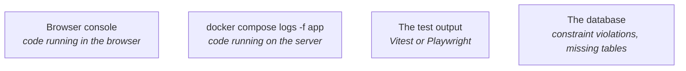

Everything so far has told you what to expect. Real work does not.

The skill that separates a stuck afternoon from a ten-minute fix is not knowing
more — it is knowing **where to look**. This step breaks three things on purpose
so you find out where each kind of failure hides.

===
## Four windows

An error in this project surfaces in exactly one of four places, and which one
tells you almost everything.



You already know why: **the browser and the server are different machines**, so
their output goes to different places. A message you cannot find is usually a
message you are looking for in the wrong window.

Keep the server log open in its own tab all day:

```bash
docker compose logs -f app
```

=== check=posts-route-restored attest=found-in-logs
## Break one: an error the browser hides

**1.** Open `app/api/posts/route.ts`. Inside the `try` in `GET`, above the
query, add:

```typescript
throw new Error('something specific I will recognise');
```

**2.** Reload [localhost:3000/api/posts](http://localhost:3000/api/posts):

```json
{"error":"Failed to list posts"}
```

That is all the browser will ever tell you. It does not say what failed, or
where.

**3.** Now look at the server log. Your message is there, with the file and the
line.

That gap is deliberate. Look at `internalError` at the bottom of the file — it
logs the real error, then answers with a flat one, because a raw error can carry
table names, queries, sometimes connection strings.

> **A 500 in the browser is not the error. It is the receipt for an error that
> was written down somewhere else.**

**4.** Put it back: `git restore app/api/posts/route.ts`

=== check=contract-restored
## Break two: an error about a file you did not touch

**1.** Open `lib/prisma/contract.ts` and rename `title` to `heading` in the
`Post` model. Save, then regenerate:

```bash
npx prisma-cli contract emit
```

**2.** Now ask the whole project:

```bash
npx tsc --noEmit
```

```
app/api/posts/route.ts(101,50): error TS2769: No overload matches this call.
  Property 'heading' is missing in type 'CreatePostInput'
```

The errors are in `app/api/posts/route.ts` and `test/helpers.ts` — **neither of
which you edited.**

That is the shape to recognise: you changed one thing, and something else
started complaining. The generated files still describe a `title`; your source
now says `heading`; everything downstream believes the generated files.

One rename, two files broken, and the error names a type you have never heard
of.

> **When something you did not touch starts failing, ask what you *did* touch
> that it depends on.**

**3.** Put it back — the contract *and* the files generated from it:

```bash
git restore lib/prisma
```

=== attest=read-the-diff
## Break three: the friendliest failure there is

**1.** In `app/api/posts/route.ts`, change `.desc()` to `.asc()`.

**2.** `npm test -- __tests__/api/posts.test.ts`

```
FAIL  returns the newest post first
  expected [ 'Older', 'Newer' ] to deeply equal [ 'Newer', 'Older' ]
```

Read what you were handed: **which behaviour** broke, **what it got**, and
**what it wanted** — enough to find the bug without opening the file.

This is what people mean when they say tests pay for themselves. Compare it with
break one, where the browser told you a thing failed and nothing else.

**3.** Put it back.

=== quiz=where-does-it-surface ask=first-question
## A method, for when there is no tutorial

Four questions, in order. Most bugs die at the second.

**1. What did I change?**

```bash
git diff
```

One second, and it rules out an entire universe of theories. Almost always the
answer is you.

**2. What did I expect, and what did I get?** Say both out loud. "I expected the
newest post first; I got the oldest." Half the time the bug becomes obvious in
the saying — which is why the rubber duck is a real technique and not a joke.

**3. Which window would know?** Browser, server log, test output, database. Look
in the right one before theorising.

**4. Can I cut the problem in half?** Comment out the second half. Log a value in
the middle. Hard-code an input. You are not looking for the bug — you are
looking for **the smallest thing that still misbehaves**, and it falls out on its
own once that is small enough.

:::note Two hours
Then ask. Bring the four answers above and you will get a useful reply in one
message instead of five:

> **Expected:** `POST /api/products` to answer 201.
> **Got:** 500, and the log says `column "price_cents" does not exist`.
> **Tried:** re-ran `contract emit`, restarted the app container.

That is not admitting defeat. It is the format that gets you unstuck fastest,
and it is what everyone senior does.
:::
