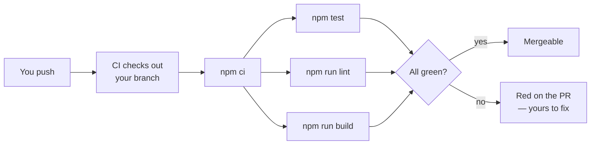
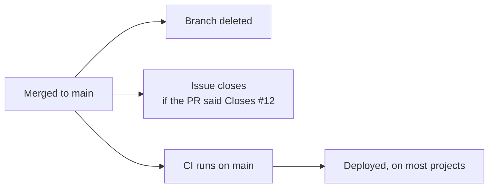

Second time through. You took the home page change all the way in
{{step:first-pull-request}} — push, open, describe, review, close — so the
mechanics are not new.

What is new is that the change is worth reviewing. A heading edit has nothing to
disagree about; a model, an endpoint and a page have decisions in them. This
step is the parts of the process that only start to matter once that is true:
what to run before you push, what runs after, and how to be reviewed and to
review.

=== attest=green-before-push
## Before you push

Two commands. Run them in this order, every time, for the rest of your career:

```bash
npm test
```

```bash
npm run lint
```

**The linter is not about style.** [ESLint](https://eslint.org/docs/latest/) is
configured by the project, and it catches a specific class of thing the type
checker cannot: a `useEffect` missing a dependency, an unused variable that
means you deleted the wrong line, a promise nobody awaited. Some of what it
flags is arguable. Fix it anyway, or discuss it as a rule change — a codebase
where the linter is always red is one where nobody reads it.

Most of what it complains about, it can fix:

```bash
npm run lint -- --fix
```

:::note This is the reviewer's time you are protecting
Every failing test and lint error a reviewer finds is a round trip: they read,
they comment, they wait, they read again. Anything a machine could have told you
in thirty seconds should never reach a person.
:::

=== check=sandbox-branch,pushed,readable-history
## Push

```bash
git push -u origin sandbox/your-name
```

`origin` is the name for the copy of the repository on GitHub. `-u` links your
local branch to the remote one, so from now on plain
[`git push`](https://git-scm.com/docs/git-push) and `git pull` know where to go.

If it fails, read the error before trying again. "Permission denied
(publickey)" means the authentication above is not set up yet, not that you did
the push wrong.

=== ask=history-recall
## What your reviewer is about to see

Before you open it: your commits are the first thing they read.

=== attest=opened
## Open the pull request

A **[pull request](https://docs.github.com/en/pull-requests)** is a request to merge your branch into `main`. It is where
the review happens: the diff, line-by-line comments, and the conversation, all
in one place.

On GitHub, your freshly pushed branch appears with a "Compare & pull request"
button. Base: `main`. Compare: your branch.

=== attest=description,linked
## Writing it

The description is the first thing a reviewer reads and it decides how good your
review is. Three things:

```markdown
## What

Adds `GET` and `POST /api/products`, a `Product` model, and a page at
`/products`.

## Why

Closes #12. The store needs products before anything can be sold.

## How to check it

1. `./script/server`
2. `npm test`
3. Visit http://localhost:3000/products and add a product

Prices are stored as integer cents — `priceCents` — rather than a decimal,
to avoid floating point rounding on money.
```

`Closes #12` is not just a note: GitHub links the two, and closes the issue
automatically when the PR merges.

That last paragraph is the one people leave out and reviewers most want. If you
made a judgement call, say what it was. Otherwise the reviewer has to guess
whether you considered the alternative or never thought about it.

:::note Keep it small
This PR is on the large side — a model, an endpoint, a page. A reviewer reading
600 lines finds fewer problems than the same reviewer reading 150, three times.
Real work is easier to review, and lands faster, when split: the model and
endpoint in one PR, the page in the next.
:::

===
## What runs without you

Pushing usually starts something. On most projects a **CI** server — continuous
integration — takes your branch, installs it from the lockfile, and runs the
checks on a machine that is not yours.



The results appear on the pull request itself, as a row of ticks or crosses.

**A red check is your job, not the reviewer's.** It is also not a judgement —
everyone's CI goes red. What matters is the gap between it going red and you
noticing.

:::note "It works on my machine"
This is what CI exists to answer, and why it installs with `npm ci` rather than
`npm install` — the lockfile exactly, no ranges re-resolved. When something
passes locally and fails there, the difference is almost always something that
only exists on your machine: a file you forgot to commit, an `.env` value, a
package you installed and never added to `package.json`.

Click into the failed check and read the log. It is the same output you would
have got locally, in a place you are not used to looking.
:::

=== attest=reviewer,responded quiz=review-feedback
## Being reviewed

Someone will comment on your code. Some things they say will be right, some will
be based on something they have misread, and some are preferences.

Three things worth internalising early:

**It is about the code.** "This could be simpler" is a statement about a
function. There is no version of it that is about you, however it lands at
first.

**A question is usually a question.** "Could this live in a plain function so it
can be tested directly?" means what it says. Two answers are both fine: *good
idea, done*, and *I tried that and it needs the request object — happy to change
it if you still think so*.

**Reply to everything.** Change it, or say why not. An unanswered comment reads
as ignored, and the reviewer has to decide whether to raise it again.

Then push more commits to the same branch — the PR updates itself. Do not open a
new one.

=== attest=reviewed-one
## Reviewing others

Half of code review is being reviewed. The other half arrives within your first
fortnight, and nobody explains it.

You will be asked before you feel qualified. Do it anyway — a reader who does
not already know how the code works is exactly who finds the parts that only
make sense if you already know.

**Read it in this order.** Not top to bottom.

1. **The description.** What is this for? If you cannot tell, that is your first
   comment, and it is a real one.
2. **The tests.** They tell you what the author thinks the code should do,
   faster than the code does. A change with no test is a fair question: what
   would break if this were wrong?
3. **The code**, now that you know what it is trying to do.
4. **Pull the branch and run it**, for anything you cannot settle by reading.

**What to actually say.** Roughly in order of value:

| Worth saying | Not worth saying |
| --- | --- |
| "I cannot follow this bit" | Anything the linter would catch |
| "What happens if this is empty?" | Restyling to your own preference |
| "This is not tested — deliberate?" | "Nit:" repeated eleven times |
| "This duplicates X in `lib/`" | Rewriting it the way you would have |

**Ask rather than instruct.** "Should this be `422`?" invites the answer "no,
because…" and you might be wrong. "Change this to `422`" does not, and you might
still be wrong.

**Say what is good.** A review that is only criticism is exhausting to receive
and tells the author nothing about what to keep doing. It costs one line.

**And approve.** A review that ends without a decision leaves the author stuck.
If your comments are things you would like fixed but do not need to see again,
approve and say so. Blocking should be rare and explicit.

:::try
Find another open pull request — a teammate's, or one on any public repository
you use. Read it in the order above and leave one comment that is a genuine
question.

The first review you write is the one where you discover how little of a diff
you can follow without the description.
:::

===
## What merging would do

You are not going to merge this one — it is a sandbox, and `main` stays exactly
as you found it. But you should not meet the button for the first time on real
work, so here is what it does.

Approved, checks green, and somebody presses it. GitHub offers three ways, and
teams usually pick one and stick to it:

| | What lands on `main` |
| --- | --- |
| **Squash and merge** | All your commits flattened into one, titled after the PR. The common default. |
| **Merge commit** | Every commit of yours, plus one commit recording the merge. |
| **Rebase and merge** | Every commit of yours, replayed onto the tip, no merge commit. |

Then, in order:



Three things follow that surprise people:

**Your branch gets deleted, and that is fine.** The commits are in `main` now.
The branch was only ever a label.

**The issue closes by itself**, if your description said `Closes #12`.

**It usually goes to production**, on the projects that deploy automatically.
The gap between "merged" and "customers have it" is often minutes.

:::note Your first merged PR
Someone else presses the button, or you do after approval — it varies by team,
and it is a fine thing to ask on day one. What does not vary: after it lands,
`git switch main && git pull` before you start the next thing. Working on a
stale `main` is how you end up with the conflicts from {{step:conflicts}}.
:::

:::warn This one gets closed, not merged
Open it, get it reviewed, respond to the comments — then **close it without
merging** in {{step:cleanup}}. The work was real; the branch is not.
:::
