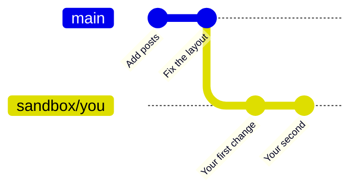
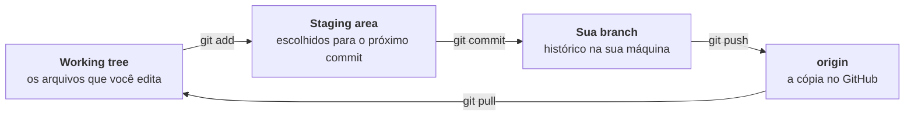

Daqui em diante tudo acontece numa branch sua.

===
## O que o git está fazendo, na verdade

O [Git](https://git-scm.com/docs) registra o histórico do seu projeto como uma
série de fotografias chamadas **commits**. Cada uma diz: aqui está o que mudou,
quem mudou e por quê.

Uma **branch** é uma etiqueta móvel apontando para um desses commits. A `main` é
a branch que todo mundo compartilha — ela deve sempre funcionar. Quando você
começa um trabalho, cria a sua própria branch, que é só uma segunda etiqueta
partindo do mesmo commit. Seus commits movem a sua etiqueta para a frente; a
`main` fica onde está.



Nada do que você commitar na sua branch afeta outra pessoa até receber merge. É
essa a razão de existirem branches: você tem o direito de errar em particular.

===
## Os quatro lugares onde seu trabalho pode estar

Uma alteração que você faz passa por quatro lugares, e um comando a move entre
cada par.



Quase todo momento de confusão com o git é, no fundo, a pergunta **em qual
desses quatro o meu trabalho está agora** — e existe um comando que sempre
responde:

```bash
git status
```

Rode o tempo todo. É gratuito, não muda nada, e diz o que está no working tree,
o que está no staging e se sua branch está à frente ou atrás do `origin`.

:::why Por que `origin` é um lugar separado, e não só um backup
`origin` é o nome da cópia no GitHub. Sua branch e `origin/main` são dois
históricos diferentes que por acaso são parentes.

É por isso que um commit não está no GitHub até você dar push, por que o
trabalho das outras pessoas não está na sua máquina até você dar pull, e por que
`git log` pode parecer completamente diferente em dois notebooks. Nada é
compartilhado automaticamente. Todo movimento por aquela última seta é um que
você faz de propósito.
:::

=== check=sandbox-branch,from-main
## Crie a sua

```bash
git switch main
git pull
git switch -c sandbox/seu-nome
```

Use seu nome de verdade — `sandbox/maria`, `sandbox/tom`. Três comandos, três
tarefas:

1. `git switch main` — partir da branch compartilhada.
2. `git pull` — pegar o trabalho mais recente de todo mundo, para você ramificar
   a partir do código atual.
3. `git switch -c <nome>` — criar uma branch nova e ir para ela.

:::note A pasta `onboarding` acabou de sumir, e está tudo bem
Este tutorial vive na própria branch, então trocar para a `main` remove a pasta
do seu disco. A página que você está lendo não é afetada — o servidor carregou
tudo para a memória ao iniciar.

Se algum dia precisar reiniciá-lo, `git switch onboarding` traz a pasta de
volta. É o comando da etapa {{step:welcome}} que você foi orientado a anotar.
:::

:::warn O prefixo importa
Chame de `sandbox/…`. Este tutorial vive numa branch chamada `onboarding`, e o
git não deixa você ter ao mesmo tempo uma branch chamada `onboarding` *e* uma
chamada `onboarding/alguma-coisa` — um nome não pode ser arquivo e pasta ao
mesmo tempo.
:::

=== quiz=name-it
## Nomeando direito

`sandbox/seu-nome` serve aqui, porque o trabalho não é real. Numa branch de
verdade o nome é lido por outras pessoas, numa lista, sem nenhum do seu
contexto:

```
patch-1        maria-work        new-stuff        test2
```

Ninguém consegue dizer o que é cada um desses, inclusive quem os criou. A
convenção:

```
tipo/numero-da-issue-descricao-curta

feature/204-product-search
fix/187-cart-total-with-discount
```

Que tipo de alteração, qual issue, e mais ou menos o que ela toca — tudo antes
de abrir qualquer coisa. O prefixo é o que diz a quem revisa o que procurar:
`refactor/` significa “confira que nada mudou”.

**A lista completa de prefixos está no manual**, na barra lateral. Ela está lá
quando você precisar — não decore.

===
## Comandos que você vai usar o tempo todo

| Comando | O que ele te diz |
|---|---|
| `git status` | O que eu mudei? Em que branch estou? |
| `git branch` | Que branches existem, e em qual estou? |
| `git switch <nome>` | Ir para uma branch existente. |
| `git switch -c <nome>` | Criar uma branch e ir para ela. |
| `git log --oneline` | O que aconteceu aqui recentemente? |

`git status` é o que se roda sempre que há dúvida. Rode agora.

:::note “Detached HEAD” e outros sustos
As mensagens de erro do git são famosas por assustar e quase nunca significam
que você perdeu trabalho. Trabalho commitado no git é muito difícil de destruir.
Se você acabar em algum lugar confuso, o `git status` normalmente aponta a
saída, e perguntar a alguém é mais rápido que chutar.
:::
