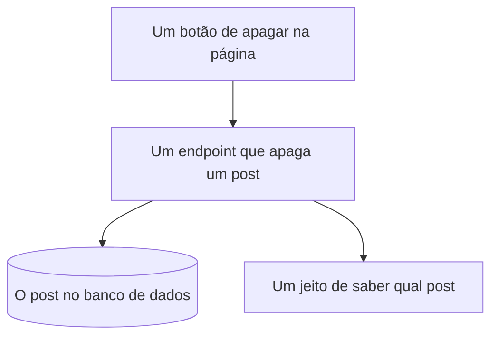

Aqui está um trabalho que alguém pode te passar numa segunda-feira:

> Deixe as pessoas apagarem os próprios posts.

Uma frase. Pequena, até. E mesmo assim não há uma primeira linha óbvia para
digitar.

Esta etapa é a habilidade que resolve isso — e é uma habilidade, não um traço de
personalidade. Quem é bom nisso está executando um procedimento que você aprende
em meia hora.

===
## Duas perguntas, não uma

“Quebrar em partes” é usado para duas coisas diferentes, e confundi-las é a forma
mais comum de um plano dar errado.

**O que precisa do quê?** A página não consegue ler de um endpoint que não
existe. O endpoint não consegue ler de uma tabela que não existe. Isso é um *fato
sobre o código* — você não tem voto nisso.

**Em que ordem vou trabalhar?** Isso é uma *escolha sobre a sua semana*.

As duas se relacionam — o que precisa do quê descarta algumas ordens — mas não
são a mesma coisa, e a primeira tem que estar resolvida antes de a segunda sequer
ser uma pergunta.

Então: dependências primeiro, sempre. Ordem depois.

=== quiz=two-questions
## O que precisa do quê

Pegue o trabalho de apagar. Pergunte de cada peça: *o que precisa já existir para
isto funcionar?*



Leia cada seta como **precisa de**. O botão precisa do endpoint. O endpoint
precisa que o post exista, e precisa que digam qual.

Nada sobre tempo ainda. Este diagrama seria idêntico se você construísse ao longo
de um ano ou de uma tarde.

===
## Depois transforme numa ordem

Agora as setas têm algo a dizer sobre tempo: **construa de baixo para cima.**
Qualquer coisa com uma seta apontando para ela tem que existir antes.

Para o trabalho de apagar, isso dá:

1. O endpoint que apaga um post
2. Algo que prove que funciona
3. O botão na página que o chama

Repare no que a dependência *não* decidiu: se você escreve o teste antes ou
depois do endpoint, ou se o botão ganha estilo hoje ou amanhã. Isso é seu. A
dependência estreita as ordens possíveis; ela não escolhe uma.

===
## Rastreie antes de confiar

Leva dois minutos, e é a parte que se pula.

**Percorra sua lista em ordem e pergunte, depois de cada linha: o que existe
agora, de fato?**

Experimente neste plano para o trabalho de apagar. Alguém escreveu com pressa.

```markdown
- [ ] Add a delete button to the post
- [ ] Add the DELETE endpoint
- [ ] Test it
```

Linha 1: existe um botão. Clicar nele não faz nada, porque não há o que chamar.
**O projeto agora parece pronto e não está** — o pior estado em que se pode
deixar qualquer coisa, porque a próxima pessoa acredita no botão.

Linha 2: o endpoint existe. Nada sobre “qual post”, então ou ele apaga o errado
ou nem roda.

Linha 3: “testar” — testar o quê? Isto é uma linha cobrindo três comportamentos,
e vai ser feita por último, mal, ou nunca.

E uma coisa que o rastreio encontra e a leitura nunca: **o que acontece quando o
post não está lá?** Ninguém escreveu, então ninguém vai construir, e isso vai ser
descoberto por quem revisa ou por um usuário.

=== quiz=trace-it
## As duas coisas que o rastreio pega

**Um passo que precisa de algo ainda não construído.** O botão antes do endpoint.
Óbvio em retrospecto, invisível enquanto você escreve a lista.

**Uma peça de que ninguém lembrou.** O caso que falta, o estado de erro, a lista
vazia. Não são falhas de competência — são coisas que só ocorrem a você quando
percorre o caminho em vez de descrevê-lo.

Aqui está o mesmo plano depois de um rastreio:

```markdown
- [ ] Add a DELETE endpoint that removes one post by id
- [ ] Prove it deletes the right one
- [ ] Answer 404 when the post does not exist
- [ ] Add the button, wired to the endpoint
- [ ] Remove the post from the list on screen once it succeeds
```

Cinco linhas em vez de três, e cada uma pode ser terminada, provada e commitada
sozinha.

===
## Quão pequeno é pequeno o bastante

Uma tarefa é uma coisa que você conseguiria terminar, provar e commitar — e
descrever numa frase sem a palavra “e”.

:::note Como saber se uma tarefa está no tamanho certo
Pergunte: depois de eu terminá-la, o projeto continua funcionando?

“Adicionar um endpoint DELETE” passa — o endpoint existe, nada está quebrado, o
botão ainda não está lá e nada finge que está. “Adicionar metade da validação”
não passa. Uma tarefa que deixa o projeto quebrado no meio foi cortada no lugar
errado.
:::

Dois modos de falha, e você vai ter um deles:

**Grande demais.** “Construir a funcionalidade de apagar.” Você não consegue
começar nem terminar, então trabalha um dia e não tem nada para marcar.

**Pequeno demais.** “Importar o cliente do banco.” Isso não é unidade de coisa
nenhuma. Se sua lista tem trinta itens e nenhum deles merece um commit, você está
escrevendo instruções para si mesmo, não um plano.

=== check=sandbox-branch,plan-exists,plan-tasks,plan-ordered ask=why-storage-first
## Sua vez, no trabalho de verdade

Agora o que você realmente vai construir:

> A Zizzu precisa de produtos. As pessoas devem conseguir ver o que está à venda
> e adicionar itens novos.

Confirme que está na sua branch de treino e crie `PLAN.md` na raiz do projeto.

**Faça na ordem que esta etapa te deu.**

1. **O que precisa do quê?** Rascunhe — no papel serve. O que tem que existir
   antes de alguém conseguir ver um produto? Antes de conseguir adicionar um?
2. **Transforme numa lista**, começando pela base da pilha.
3. **Rastreie.** Percorra sua própria lista e pergunte depois de cada linha o que
   existe agora. Corrija o que isso encontrar — vai encontrar alguma coisa.

```markdown
# Products

**Done when:** anyone can see the products at /products and can add a new one.

- [ ] ...
```

Cinco tarefas ou mais. Perguntas que vale fazer enquanto rastreia:

- Onde um produto mora antes de alguém conseguir ler um de volta?
- Ler e escrever são trabalhos diferentes. São uma tarefa ou duas?
- O que deveria acontecer se alguém digitar um preço de `-5`? De quem é essa
  tarefa?
- Como alguém saberia que cada peça funciona?

:::note Palavras que você ainda não viu
Escreva na linguagem que você tem. “Fazer um lugar para guardar produtos” é tão
bom quanto a mesma coisa no jargão que ninguém te ensinou. Ninguém está corrigindo
vocabulário.
:::

=== ask=plan-review
## Peça uma segunda opinião

As verificações acima conseguem contar suas tarefas e pegar uma página construída
antes daquilo de que ela lê. O que elas não conseguem te dizer é se uma tarefa é
mesmo *uma* tarefa, ou se você esqueceu uma peça — e é isso que faz a maior parte
da diferença entre uma boa e uma má decomposição.

Então cole sua lista abaixo e receba uma leitura.

Isto não vai te impedir de continuar, diga o que disser, e não é uma nota. É o
que você conseguiria virando para a pessoa ao lado e perguntando “isto parece
certo?” — que, num time de verdade, é o que você deveria fazer com seus primeiros
planos de qualquer forma.

:::note Se discordar de você
É uma segunda opinião, não um veredito, e ela não viu a base de código. Onde ela
e sua lista divergirem, o movimento interessante é descobrir qual dos dois está
certo — e se for você, acabou de descobrir que consegue defender seu plano.
:::
