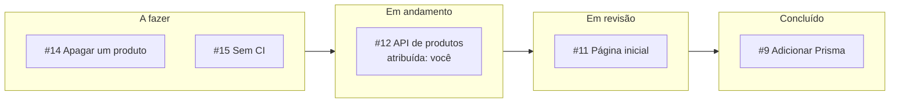
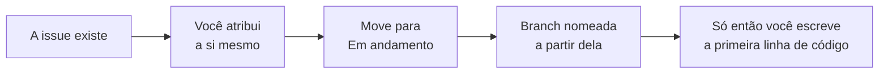

Você tem um plano. Num time de verdade você ainda não começaria a digitar — o
trabalho primeiro é escrito e reivindicado, para que todos vejam que ele existe e
quem está com ele.

É essa a etapa. Vinte minutos, e depois você constrói.

===
## Issues

Uma **[issue](https://docs.github.com/pt/issues)** é um pedaço de trabalho: um
bug, uma funcionalidade, uma pergunta. Ela tem um título, uma descrição e uma
conversa junto.

O motivo de as issues existirem não é burocracia. É que a alternativa — trabalho
morando na cabeça de alguém, ou numa conversa de mensagens — faz com que duas
pessoas construam a mesma coisa, ou ninguém construa, e seis meses depois ninguém
lembre por que uma decisão foi tomada.

A issue é onde mora o *porquê*. O código só mostra o *quê*.

===
## O quadro

O **[quadro do projeto](https://docs.github.com/pt/issues/planning-and-tracking-with-projects)**
é cada issue como um cartão numa coluna:



Uma olhada responde: o que está sendo feito, por quem, e o que está esperando
alguém.

**Mover seu cartão não é burocracia — é como você comunica.** Um cartão parado em
“A fazer” no qual você trabalhou a semana inteira significa que outra pessoa pode
pegá-lo, e sua atualização na daily está errada antes de você dá-la.

=== attest=assigned,in-progress,commented
## Reivindicando trabalho

Abra o repositório no GitHub — o mesmo que você clonou — e encontre a aba
**Issues**, e a aba **Projects** ao lado. O quadro está lá.

1. Ache uma issue em **A fazer** que não esteja atribuída a ninguém.
2. Leia direito. Tudo, inclusive os comentários.
3. Atribua a você. É a bandeira que diz *esta aqui está pega*.
4. Mova para **Em andamento**.
5. Comente como você pretende abordá-la — uma ou duas frases.

:::note Se não houver nada lá
Alguém deveria ter colocado as issues de treino no quadro antes de você começar,
e se o quadro está vazio ou não tem aba Projects, isso é um passo de configuração
que ficou faltando — não algo que você fez errado.

Pergunte a quem preparou seu ambiente. Enquanto espera, siga para a etapa
{{step:database}} e volte depois: nada após esta etapa depende do quadro.
:::

Aquele último item parece desnecessário e é o mais valioso. Se você entendeu a
issue errado, é aqui que descobre, ao custo de trinta segundos. A alternativa é
descobrir na revisão, depois de dois dias de trabalho.

> Vou adicionar um modelo `Product` e um `GET`/`POST /api/products` seguindo o
> padrão de `posts`. Me avisem se o preço deveria ser decimal em vez de centavos.

Seu `PLAN.md` da etapa anterior já é a maior parte desse comentário.

===
## Nomes de branch

Agora a convenção de nomes da etapa {{step:branch}} tem algo real a que se
prender. A issue que você acabou de reivindicar te dá o número e as palavras:

```
feature/204-product-search
fix/187-cart-total-with-discount
```

Reivindique a issue, depois nomeie a branch a partir dela. Quem olhar sua branch
sabe para que ela é e onde está a discussão.

(Neste tutorial você continua em `sandbox/seu-nome` — o trabalho não é real,
então não ganha nome real.)

Então a ordem num dia de verdade é:



Você acabou de fazer os quatro primeiros para o trabalho que vem. Daqui em diante
é tudo a última caixa.

=== quiz=stuck
## Pedindo ajuda

Você vai travar. Todo mundo trava, toda semana. O único erro é travar em
silêncio.

Uma pergunta útil tem três partes:

> **O que eu esperava:** que `POST /api/products` respondesse 201.
> **O que aconteceu:** 500, e o log diz `column "price_cents" does not exist`.
> **O que eu tentei:** rodei `contract emit` de novo, reiniciei o contêiner do app.

Esse formato faz duas coisas. Prova que você fez o trabalho, e permite que alguém
responda numa mensagem em vez de cinco. Regra grosseira: **duas horas travado é
o bastante.** Ninguém se impressiona com uma semana em silêncio.

:::note Sobre a palavra “júnior”
Fazer perguntas não é uma fase que se supera. Pessoas sênior fazem mais
perguntas, não menos — só aprenderam quais valem a pena, e que não saber algo é
um fato e não uma confissão.
:::
