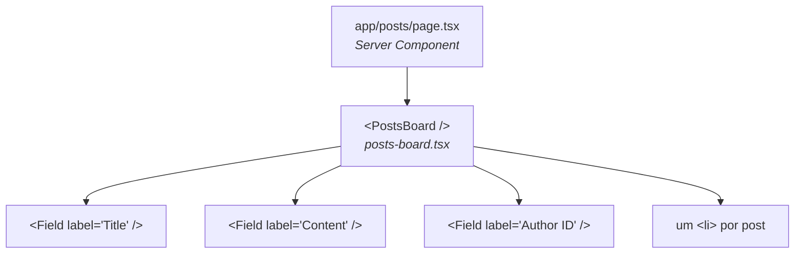

Você já editou três arquivos `.tsx`, e ninguém te disse como se chamam as coisas
dentro deles.

Isso acaba aqui. Tudo abaixo está em `app/posts/posts-board.tsx` e
`app/page.tsx` — os dois arquivos que você já tem abertos.

===
## Um componente é uma função que devolve marcação

Abra `app/posts/posts-board.tsx` e vá até o fim. O `Field` é a ideia inteira em
vinte linhas:

```tsx
function Field({ label, name, required, placeholder }: {
  label: string;
  name: string;
  required?: boolean;
  placeholder?: string;
}) {
  return (
    <label className="flex flex-col gap-1 text-sm">
      <span>{label}</span>
      <input name={name} required={required} placeholder={placeholder} />
    </label>
  );
}
```

É isso. Uma função. Ela devolve marcação em vez de um número.

**A letra maiúscula não é estilo.** O React a usa para distinguir os seus
componentes das tags do navegador: `<Field />` é seu, `<input />` é do navegador.
Escreva `<field />` e o React procura um elemento HTML chamado `field`, não acha
nada, e não renderiza nada — sem erro.

===
## Props são os argumentos dele

Suba no mesmo arquivo. O `Field` é chamado três vezes:

```tsx
<Field label="Title" name="title" required />
<Field label="Content" name="content" />
<Field label="Author ID" name="authorId" required placeholder="UUID of an existing user" />
```

Cada uma dessas é uma chamada de função. `label="Title"` define o parâmetro
`label`. `required` sozinho significa `required={true}`.

O bloco de tipo logo depois dos parâmetros lista quais props existem e quais são
opcionais — é o `?` da etapa {{step:typescript}}, fazendo o mesmo trabalho aqui.

Três chamadas, uma definição, três campos que não conseguem divergir. É por isso
que você escreve um componente em vez de copiar o bloco `<label>` três vezes.

:::note Você já viu um de uma biblioteca
O `app/page.tsx` tem isto perto do topo:

```tsx
<Image src="/next.svg" alt="Next.js logo" width={100} height={20} priority />
```

Maiúsculo, então é um componente. `src` e `alt` são props. `width={100}` é uma
prop cujo valor é um número em vez de texto — o que exige chaves, porque
`width="100"` seria a string.

É a mesma regra do `{ }` da etapa {{step:first-change}}, agora na posição de
atributo: **chaves significam que a próxima coisa é JavaScript**, onde quer que
apareçam.
:::

===
## Como os dois arquivos se encaixam

A etapa {{step:two-machines}} te fez colocar um log em cada um destes e ver os
dois imprimirem em lugares diferentes. Aqui está a parte que aquela etapa não
disse: um deles renderiza o outro.



Uma página é uma árvore de componentes, cada um uma chamada de função cujo
resultado é colocado dentro do que está acima. O `page.tsx` é curto porque quase
tudo o que ele faz é dizer *coloque o board aqui*.

===
## Mais duas coisas que você vai ler o tempo todo

**Renderização condicional.** Não existe `if` dentro da marcação, então uma
condição é uma expressão que produz ou algo ou nada:

```tsx
{createState.error ? <p role="alert">{createState.error}</p> : null}
```

`null` não renderiza nada.

Mais abaixo no mesmo arquivo há uma versão mais longa —
`loadError ? … : posts === null ? … : posts.length === 0 ? … : …`.
São **quatro estados de uma lista**,
em ordem: falhou, ainda carregando, carregada e vazia, carregada com coisas.

Toda lista que você construir precisa das quatro, e a vazia é a que as pessoas
esquecem.

**Listas e `key`.** Para renderizar muitas coisas você mapeia sobre um array:

```tsx
{posts.map((post) => <li key={post.id}>{post.title}</li>)}
```

`key` é como o React distingue um item de outro entre renderizações. Dê algo
estável e único — um id do banco. **Não o índice do array**, que muda assim que
algo é inserido ou removido, fazendo o React casar as linhas erradas.

=== attest=poked-it
## Cutuque antes de construir um

Cinco minutos mudando coisas e recarregando. Nada aqui é commitado e tudo é
desfeito no fim — o ponto é sentir quais edições mudam uma coisa e quais mudam
várias.

Deixe [localhost:3000/posts](http://localhost:3000/posts) aberto com o
`docker compose watch` rodando, para que um save apareça no navegador.

**1. Mude uma chamada.** Em `posts-board.tsx`, ache
`<Field label="Title" name="title" required />` e mude o label para `Headline`.
Salve, recarregue.

*Um* campo mudou. Você passou um argumento diferente para uma chamada.

**2. Mude a definição.** Agora desça até o `Field` no fim e dê um fundo ao
`<span>`:

```tsx
<span className="bg-amber-200 text-zinc-600 dark:text-zinc-400">{label}</span>
```

Salve, recarregue. **Os três labels ficaram amarelos.** Uma edição, três lugares
— é isso que você comprou escrevendo um componente em vez de copiar o bloco.

**3. Estilize um item da lista.** Adicione um post pelo formulário se a lista
estiver vazia, ache o `<li>` e troque o `rounded-lg` por `rounded-none`, ou
acrescente `bg-zinc-100`. Veja todos os posts da lista mudarem juntos, pelo mesmo
motivo.

**4. Ache o estado vazio.** Mude `No posts yet.` para outra coisa. Não vai
aparecer — você tem posts. É o ternário: aquele texto só renderiza quando
`posts.length === 0`.

**Agora devolva tudo:**

```bash
git restore app/posts/posts-board.tsx
```

:::note Para que serviram esses cinco minutos
Editar um componente que você não escreveu, ver o que se move e desfazer é a
maior parte do que a sua primeira quinzena parece. O hábito que vale levar é o
último comando: cutuque à vontade, porque `git restore` significa que nada do
que você tentou é permanente.
:::

=== check=sandbox-branch,tagline-component,tagline-rendered,tagline-served
## Agora escreva um

Você leu quatro componentes. Escreva um.

Pegue o slogan que você acrescentou à página inicial na etapa
{{step:first-change}} e mova para um componente próprio.

**1.** Crie `app/tagline.tsx` — nome de arquivo em kebab-case, componente em
PascalCase, a regra da etapa {{step:naming}} finalmente com algo real a que se
prender:

```tsx
export function Tagline({ text }: { text: string }) {
  // devolva o <p> que você escreveu, com {text} onde estavam suas palavras
}
```

**2.** Em `app/page.tsx`, importe e renderize onde o parágrafo estava:

```tsx
import { Tagline } from './tagline';
```

```tsx
<Tagline text="Tudo o que você precisa, e algumas coisas que não." />
```

**3.** Recarregue. **A página deve estar exatamente como estava antes.**

É esse o teste inteiro. Você mudou como a página é construída e não o que ela
mostra — que é o que quase toda refatoração é, e por que os testes que você
escreve na semana dois valem a pena.

:::note Por que um export nomeado aqui, e um default no `page.tsx`
`page.tsx` e `route.ts` são encontrados pelo Next.js *pela posição nas pastas*,
então ele precisa de uma única coisa óbvia para pegar: o export default.

Todo o resto é export nomeado, para que o import tenha que dizer o que quer —
`import { Tagline }` — e seu editor consiga encontrar, renomear e avisar quando
sumir. Siga o arquivo ao lado e você acerta isso sem pensar.
:::

:::try
Commite sozinho. `Move the tagline into its own component` é um bom assunto: diz
o que mudou, e quem revisar sabe que precisa conferir que nada ficou diferente.
:::

=== check=highlights-list,highlights-empty,highlights-rendered
## Agora um que renderiza uma lista

O `Tagline` mostra uma coisa. A maioria dos componentes mostra *várias* — e é aí
que as duas ideias do card anterior se encontram.

Crie `app/highlights.tsx`. Ele recebe um array de strings e os renderiza como uma
lista:

```tsx
export function Highlights({ items }: { items: string[] }) {
  // se não houver nenhum, não renderize nada
  // caso contrário, uma <ul> com um <li> por item
}
```

Depois coloque na página inicial, abaixo do seu slogan, com alguns itens de
verdade:

```tsx
<Highlights items={['Devolução grátis', 'Entrega no dia seguinte']} />
```

Três coisas sobre as quais este exercício de fato é, e as três são verificadas:

**O array é JavaScript**, então a prop precisa de chaves — `items={[...]}`, não
`items="..."`. Mesma regra do `width={100}`.

**Todo `<li>` precisa de uma `key`.** Use o próprio texto: `key={item}`. Não a
posição no array — ela muda quando algo é inserido, e o React passa a casar as
linhas erradas.

**Decida o que uma lista vazia faz.** Passar `items={[]}` deveria não renderizar
nada, e não uma caixa vazia com um buraco onde a lista estaria. Ou devolva `null`
cedo, ou coloque a condição na marcação — as duas são normais.

:::note Você vai reencontrar as três
O board que você conserta na etapa {{step:ui}} tem uma `key` faltando, e é um de
três bugs que você precisa achar sem que ninguém diga onde. Ter escrito uma você
mesmo é a diferença entre reconhecer e ter lido a respeito.
:::

:::try Prove o caso vazio
Mude a prop para `items={[]}`, recarregue, e confira que a página não tem um
espaço sobrando onde a lista estava. Depois devolva seus itens.
:::

===
## O que você já consegue ler

Volte ao `posts-board.tsx` e leia de cima a baixo. Você não vai acompanhar tudo —
o `useActionState` e o tratamento do formulário são um mecanismo de que você
ainda não precisa, e o `docs/` tem isso para quando precisar.

Mas você já consegue nomear a maior parte do que vê: um componente, suas props, a
marcação que ele devolve, as condições decidindo o que aparece, e a lista sendo
mapeada.

Uma coisa nele ainda não foi explicada, e é a linha que decide onde o arquivo
inteiro roda. Essa é a próxima etapa.
