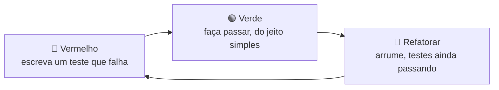

Você já sabe o que é um teste, e viu um pegar uma quebra de verdade.

Falta uma pergunta antes de escrever o seu: como você sabe se um teste que você
escreveu presta? Comece com um experimento de dois minutos.

=== check=limit-restored attest=green-but-broken
## Quebre algo de propósito

A funcionalidade `posts` está pronta e os testes dela passam todos. Vamos ver o
que isso de fato garante.

**1.** Abra `app/api/posts/route.ts` e ache esta linha perto do topo:

```typescript
const TITLE_MAX_LENGTH = 200;
```

**2.** Mude o `200` para `5`. Salve.

**3.** Rode os testes:

```bash
npm test
```

**Tudo verde.**

**4.** Agora use o app. Confirme que ele está rodando e então:

```bash
curl -s -X POST http://localhost:3000/api/posts \
  -H 'Content-Type: application/json' \
  -d '{"title":"My first post","authorId":"0199c0de-1a2b-7c3d-8e4f-5a6b7c8d9e0f"}'
```

```json
{"error":"`title` must be at most 5 characters"}
```

O app agora rejeita qualquer título maior que uma palavra. Todos os testes
passam.

**5.** Volte o `200` e salve.

===
## O que isso significa

Você acabou de quebrar o app e a suíte de testes não percebeu.

Isso não é um bug nos testes. Ninguém nunca escreveu um teste para o limite do
título, então nada estava olhando. Uma suíte verde significa uma coisa só:

> **Os comportamentos que alguém deixou escritos continuam funcionando.**

O que levanta a pergunta que vistos verdes não respondem: **o teste que eu
acabei de escrever está olhando alguma coisa?**

Um teste que você só viu passar pode não estar ligado a nada. Um erro de
digitação no nome da coisa que ele importa, uma asserção que é verdadeira de
qualquer jeito — os dois parecem exatamente um teste passando.

Há um jeito de descobrir, e leva um segundo: **veja-o falhar primeiro.**

===
## Vermelho, verde, refatorar

O ciclo que você vai ouvir nomearem o tempo todo:



1. **Vermelho.** Escreva um teste para algo que ainda não existe. Rode. Veja
   falhar.
2. **Verde.** Escreva o código mais simples que faça passar.
3. **Refatorar.** Arrume, com o teste ali para te pegar.

Duas coisas diferentes estão embrulhadas aí, e elas não têm o mesmo respaldo.
Vale separar, porque vão te mandar fazer as duas.

**Ver falhar não é opcional.** Você provou isso a si mesmo há pouco. Vermelho
primeiro leva um segundo e não tem substituto.

**Escrever o teste *antes* do código é preferência, não lei.** Um estudo
cuidadoso disso — [Fucci et al., 2017](https://arxiv.org/abs/1611.05994) — pegou
pessoas desenvolvedoras fazendo teste-primeiro e teste-depois e concluiu que a
ordem “não teve influência importante” sobre quanto entregaram ou quão correto
ficou. O que *previu* melhores resultados foi outra coisa nos mesmos dados:
trabalhar em **passos pequenos e regulares**, em qualquer ordem que o teste
viesse.

Então o que de fato se copia do TDD é o tamanho dos passos.

| | |
| --- | --- |
| Duas horas de código, depois descobrir | Lento de depurar, penoso de revisar, fácil de se perder |
| Vinte minutos, depois descobrir | Você sabe o que quebrou, porque só fez uma coisa |

Dá para chegar lá com teste-primeiro ou teste-depois. O que não dá é escrever
tudo e descobrir no fim.

:::why Por que teste-primeiro ainda ajuda, mesmo sem a evidência respaldando a ordem
Ele te obriga a dizer o que a coisa deve *fazer* antes de você pensar em como ela
funciona — então você a descreve de fora, do jeito que ela será usada, em vez de
por dentro, onde é fácil construir algo desajeitado e não perceber.

Ele também torna passos pequenos o caminho de menor resistência: um teste que
você tem que escrever antes é um passo que você tem que definir antes. Pode ser
esse o efeito inteiro — a ordem te dá a granularidade, e a granularidade faz o
trabalho.

O curso ensina teste-primeiro por esse motivo. Se você se pegar escrevendo o
código antes e o teste depois, não está errado, desde que os passos continuem
pequenos e o teste seja visto falhando antes de você confiar nele.
:::

===
## Como é um teste aqui

Um Route Handler é só uma função — recebe uma requisição, devolve uma resposta.
Então um teste monta uma requisição, chama a função e olha o que volta. Sem
servidor envolvido.

Todo teste segue os mesmos três tempos:

```typescript
it('does the thing', async () => {
  // 1. arrange — prepare o que este teste precisa
  const author = await createUser();

  // 2. act — faça a única coisa sendo testada
  const response = await POST(postRequest('/api/posts', { title: 'Hello', authorId: author.id }));

  // 3. assert — verifique o que aconteceu
  expect(response.status).toBe(201);
});
```

Arrange, act, assert. Nessa ordem, sempre. Quando um teste está difícil de ler,
normalmente é porque esses três foram embaralhados.

O executor de testes é o [Vitest](https://vitest.dev/), e `describe`, `it` e
`expect` estão disponíveis sem precisar importar.

Duas coisas te são dadas:

- **`test/helpers.ts`** — `createUser()`, `createPost()`. Elas colocam linhas no
  banco para que seu teste não pareça encanamento de banco de dados.
- **`test/request.ts`** — `getRequest(path)`, `postRequest(path, body)`. Elas
  montam o objeto da requisição.

E uma coisa acontece invisivelmente: **todo teste começa com as tabelas vazias.**
Você nunca limpa depois de si, e nenhum teste pode ser afetado por outro que
rodou antes.

=== check=sandbox-branch,test-exists,no-route-yet
## Seu teste

Crie `__tests__/api/products.test.ts` com um teste: `GET /api/products` devolve
uma lista vazia quando não há produtos.

```typescript
import { GET } from '@/app/api/products/route';
import { getRequest } from '@/test/request';

describe('GET /api/products', () => {
  it('returns an empty list when there are no products', async () => {
    const response = await GET(getRequest('/api/products'));

    expect(response.status).toBe(200);
    expect(await response.json()).toEqual({ data: [] });
  });
});
```

Sim, ele importa um arquivo que não existe. É esse o ponto.

:::note O que `@/` significa
Um atalho para a raiz do projeto, configurado em `tsconfig.json`. `@/test/request`
significa `test/request` a partir do topo do projeto — para que um arquivo possa
mudar de pasta sem quebrar todos os imports dentro dele.
:::

=== check=red,test-committed
## Rode e leia a falha

```bash
npm test -- __tests__/api/products.test.ts
```

Ele falha — algo como `Failed to resolve import "@/app/api/products/route"`.

Leia direito. Ele não está dizendo “você fez algo errado”; está dizendo “a coisa
que você pediu ainda não está lá”, que é o que você esperava. Ficar à vontade
lendo saída de falha é a maior parte do que separa alguém rápido de alguém
travado.

:::try
Escreva o teste, rode, veja falhar, e então **commite sozinho**.

Commitar um teste que falha parece errado. Não é: o commit é uma declaração do
que o código deve fazer, e o commit seguinte torna aquilo verdade. A verificação
abaixo procura exatamente esse par, nessa ordem.

Algo como: `Add a failing test for GET /api/products`
:::

=== check=sandbox-branch,route-exists,runtime,green
## O arquivo

Crie `app/api/products/route.ts`:

```typescript
import type { NextRequest } from 'next/server';
import { db } from '@/lib/prisma/db';

// The Postgres driver needs Node APIs, which the Edge runtime does not have.
export const runtime = 'nodejs';

/**
 * `GET /api/products` — newest first.
 */
export async function GET(request: NextRequest) {
  try {
    const products = await db.orm.public.Product.orderBy((product) =>
      product.createdAt.desc(),
    ).all();

    return Response.json({ data: products });
  } catch (error) {
    console.error('Failed to list products', error);

    return Response.json({ error: 'Failed to list products' }, { status: 500 });
  }
}
```

Rode:

```bash
npm test -- __tests__/api/products.test.ts
```

Verde.

===
## O que cada parte está fazendo

**`export async function GET`** — o nome é o método HTTP. O Next.js procura
exports chamados `GET`, `POST`, `PATCH`, `DELETE` e chama o que corresponder à
requisição. Uma função por método, nenhum código de roteamento para escrever.

**`export const runtime = 'nodejs'`** — o Next.js consegue rodar um handler num
[ambiente “Edge”](https://nextjs.org/docs/app/api-reference/edge) enxuto que não
tem APIs do Node. O driver do Postgres precisa delas.

O Node já é o padrão, então esta linha não muda nada hoje. É uma **convenção da
casa**: o `docs/api-routes.md` pede isso em todo handler que encosta no banco,
para que quem for adicionar `runtime = 'edge'` depois tenha que apagar uma linha
que diz por que não deveria.

**`db.orm.public.Product`** — o construtor de consultas que o
[Prisma](https://www.prisma.io/docs) gerou a partir do seu contrato. Digite
`db.orm.public.Product.` no seu editor e deixe o autocomplete te mostrar o que
existe. Alguns que você vai usar:

```typescript
await db.orm.public.Product.all();                          // todas as linhas
await db.orm.public.Product.where({ id }).first();          // uma linha, ou null
await db.orm.public.Product.orderBy((p) => p.name.asc()).take(20).all();
await db.orm.public.Product.create({ name, priceCents });   // insere, devolve a linha
```

`.first()` devolve `null` quando não há correspondência. Ele não lança erro —
então qualquer coisa que volte dele precisa ser verificada antes de ser usada.

**[`Response.json({ data: products })`](https://developer.mozilla.org/pt-BR/docs/Web/API/Response)**
— 200 por padrão. O envelope `{ data }` é a convenção do projeto, e agora seu
endpoint também a mantém.

**O `try`/`catch`** — se o banco estiver fora, quem chamou recebe um 500 genérico
e o erro real vai para o log do servidor, onde o time consegue ver. Nunca envie o
erro cru ao navegador.

:::note O ramo do 500 não tem teste, deliberadamente
Testá-lo exigiria um banco que falha sob demanda. O `docs/testing.md` explica o
raciocínio: alguns ramos custam mais para testar do que valem, e dizer isso em voz
alta é melhor que fingir que a lacuna não existe.
:::

=== attest=wrote-too-much
## Não escreva código que o teste não pediu

“Escreva o código mais simples que faça passar” é a frase com que todo mundo
concorda e ninguém segue. Vale dois minutos ver o que quebra quando você a
ignora.

**1.** Seu `GET /api/products` funciona e um teste o cobre. Agora adicione algo
que ninguém pediu — um limite, o tipo de coisa que dá para imaginar precisando:

```typescript
const url = new URL(request.url);
const limit = Number(url.searchParams.get('limit') ?? 50);

const products = await db.orm.public.Product.orderBy((product) =>
  product.createdAt.desc(),
).take(limit).all();
```

**2.** Rode a suíte.

```bash
npm test
```

Verde. Claro que sim — nenhum teste menciona `limit`.

**3.** Agora apague aquelas duas linhas e devolva o `.all()`.

**4.** Rode de novo. **Verde também.**

===
## O que isso te mostrou

A suíte deu a mesma resposta com e sem a funcionalidade. Ela não tinha opinião
nenhuma, porque ninguém escreveu uma opinião.

Então você tinha um ramo num arquivo cujos testes passam, que é o tipo de código
mais caro que existe:

| | |
| --- | --- |
| Código sem teste num arquivo sem teste | Óbvio. Todo mundo tem cuidado por perto. |
| Código sem teste num arquivo **testado** | Invisível. Ele herda o visto verde do arquivo. |

O `limit` teria ido para produção. Seria lido pela próxima pessoa como coberto,
porque tudo em volta está. E no dia em que alguém passar `?limit=abc`,
`Number('abc')` é `NaN`, `.take(NaN)` faz sabe-se lá o quê, e a suíte de testes
continua dizendo que está tudo bem.

**A regra, e ela é verificável:** se você consegue apagar uma linha e nenhum
teste falha, você tem duas opções honestas — escrever o teste, ou apagar a
linha. Decidir qual é o trabalho. Não fazer nenhuma das duas é como uma base de
código se enche de coisa que ninguém ousa tocar e ninguém consegue justificar.

:::note É isto que o “mais simples” está protegendo
Não é elegância, e não é digitar menos. É que toda linha que você escreve deveria
ser rastreável até algo que falhava sem ela. É isso que faz uma suíte significar
alguma coisa: não que ela seja grande, mas que o código e os testes foram
construídos a partir da mesma lista.

O limite é uma funcionalidade perfeitamente boa. Ela só precisa de uma issue, de
um teste que falhe sem ela, e de uma decisão sobre `?limit=abc` — o que dá quinze
minutos, e você acabou de ver por que pular isso custa mais.
:::

=== check=order quiz=envelope ask=why-red-first
## Agora commite — separado

O teste já está commitado. Commite a rota como alteração própria, para que o
histórico fique:

```
a1b2c3d  Add a failing test for GET /api/products
e4f5g6h  Add GET /api/products
```

Qualquer pessoa pode fazer checkout do primeiro commit, rodar o teste e vê-lo
falhar. Essa é a sua evidência de que o teste é real.

:::warn Se você commitou os dois juntos
`git reset --soft HEAD~1` desfaz o último commit mas mantém as alterações no
staging. Depois `git restore --staged app/api/products/route.ts`, commite o teste
e commite a rota. A verificação abaixo vai te avisar se a ordem estiver errada.
:::

===
## Experimente de verdade

```bash
curl http://localhost:3000/api/products
```

Você deve receber `{"data":[]}`. Se receber 500, o contêiner do app não rodou o
`db init` para o banco de desenvolvimento — volte à etapa {{step:database}}.

:::try Prove que seu teste ainda consegue falhar
Troque `{ data: products }` por `{ data: [] }` no handler e rode o teste de novo.
Ele passa — porque seu único teste só cria zero produtos, então um endpoint que
sempre devolve nada o satisfaz completamente.

Volte atrás. Até agora você descreveu um caso, e um caso é tudo o que sua suíte
protege.
:::
