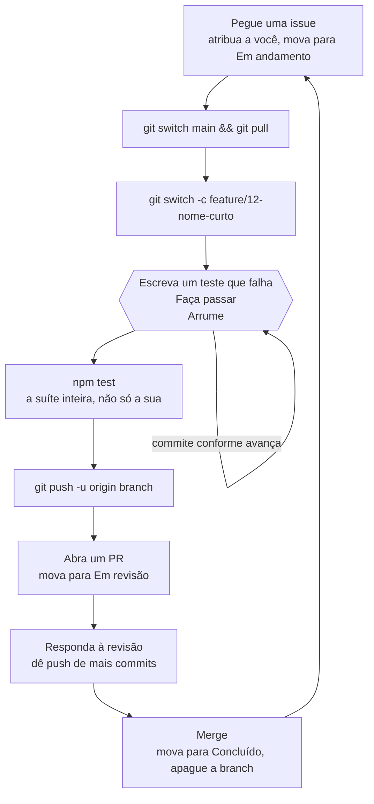

Última etapa. Feche o ciclo, devolva o repositório ao estado em que você o
encontrou, e leve a cola com você.

=== check=back-on-main,main-untouched attest=closed,issue-done
## Encerrando

1. **Feche seu pull request sem fazer merge.** Na página do PR: “Close pull
   request”, abaixo da caixa de comentário.
2. **Mova sua issue para Concluído** no quadro.
3. **Apague os arquivos de rascunho que você criou pelo caminho.** O `PLAN.md`
   eram suas anotações de trabalho — numa branch de verdade essa lista mora na
   issue, não no repositório:

```bash
rm PLAN.md
```

(Se em algum momento você o commitou, use `git rm PLAN.md` e commite a remoção. O
`git status` te diz em qual caso você está.)

   O `lib/products.ts` e os testes dele você mantém. Isso é código real e
   testado.

4. **Volte para a `main`:**

```bash
git switch main
```

Sua branch ainda existe, e todos os seus commits também — fechar um PR não apaga
nada. Se quiser que ela suma:

```bash
git branch -D sandbox/seu-nome
git push origin --delete sandbox/seu-nome
```

Apagar uma branch já mergeada é arrumação normal num projeto de verdade. O
trabalho está na `main`; a etiqueta é só entulho.

===
## As duas coisas que o git não devolve

A etapa de boas-vindas prometeu que elas estariam aqui.

**Arquivos que você nunca commitou.** Trocar de branch leva arquivos não
rastreados junto, porque o git não está olhando para eles. Um `git status` na
`main` lista o que sobrou — apague o que você não quiser.

**O banco de dados de desenvolvimento.** Ele é um volume do Docker, não um
arquivo do projeto, então nada do que você faz no git o toca. O seu ainda tem a
tabela `Product` que você criou, e a `main` não tem contrato que mencione uma.

Essa divergência vale limpar, porque o `db init` também *assina* o banco com o
contrato a partir do qual ele foi construído — então um banco construído a partir
da sua branch e um app rodando a `main` já não concordam sobre qual deveria ser o
esquema:

```bash
docker compose exec app npx prisma-cli db verify
```

Para começar limpo, jogue o banco fora e reconstrua a partir da `main`:

```bash
docker compose down -v
```

```bash
./script/server
```

```bash
docker compose exec app npx prisma-cli db init --no-interactive --yes
```

:::warn O `-v` apaga os dados
Essa flag remove o volume, que é justamente o objetivo aqui — mas é a mesma flag
num projeto onde os dados importam. Leia o que um comando do compose faz com
volumes antes de rodá-lo em qualquer lugar que não seja a sua própria máquina.
:::

---

===
## O ciclo, daqui em diante

Todo trabalho que você fizer se parece com isto:



===
## Comandos

**Todo dia**

```bash
./script/server                  # sobe os contêineres
docker compose watch             # sincroniza suas edições para o contêiner do app
docker compose logs -f app       # o que o servidor está realmente dizendo?
npm test                         # a suíte do Vitest
npm test -- caminho/para/um.test.ts  # só um arquivo
npm run test:e2e                 # Playwright (pare o contêiner do app antes)
```

**Git**

```bash
git status                       # na dúvida, rode isto
git diff                         # o que eu mudei?
git switch -c feature/12-coisa   # branch nova
git add <arquivo>                # coloca uma alteração no staging
git commit                       # registra
git commit --amend               # corrige o último commit (antes do push)
git log --oneline                # histórico recente
git push -u origin <branch>      # primeiro push de uma branch
```

**Pensar**

```
Decompor   →  tarefas pequenas, cada uma deixando o projeto funcionando
PREP       →  Parâmetros, Retornos, Exemplos, Pseudocódigo
TDD        →  vermelho, verde, refatorar
```

**Banco de dados**

```bash
npx prisma-cli contract emit                                   # depois de editar contract.ts
docker compose exec app npx prisma-cli db init --no-interactive --yes
docker compose restart app                                     # recarrega o contrato
```

===
## Onde procurar as coisas

| Pergunta | Onde |
|---|---|
| Como eu adiciono um endpoint? | `docs/api-routes.md`, e `app/api/posts/route.ts` |
| Como funciona o roteamento do Next.js? | [Documentação do Next.js](https://nextjs.org/docs/app/api-reference/file-conventions/route) |
| Como eu escrevo um teste? | `docs/testing.md`, e `__tests__/api/posts.test.ts` |
| O que o `expect` consegue fazer? | [Vitest](https://vitest.dev/api/expect.html) · [Playwright](https://playwright.dev/docs/locators) |
| Como eu consulto o banco? | `docs/prisma-next.md`, e a [documentação do Prisma](https://www.prisma.io/docs) |
| Como funciona uma página? | `app/posts/page.tsx` e `app/posts/posts-board.tsx` |
| Server ou client component? | [Documentação do Next.js](https://nextjs.org/docs/app/getting-started/server-and-client-components) |
| O que este comando do git faz? | [git-scm.com/docs](https://git-scm.com/docs), ou [o livro Pro Git](https://git-scm.com/book/pt-br/v2) |
| O que este código de status significa? | [MDN](https://developer.mozilla.org/pt-BR/docs/Web/HTTP/Reference/Status) |

Quando esses não responderem, pergunte. Duas horas é o bastante.

===
## O que de fato lembrar

A maior parte do que você fez hoje foi mecânica, e mecânica você absorve sem
tentar. Seis coisas valem levar deliberadamente:

**Quebre em partes antes de começar.** Uma lista de tarefas pequenas transforma
um trabalho assustador num óbvio, e te diz amanhã onde você estava hoje.

**Faça PREP antes de digitar.** Parâmetros, retornos, exemplos, pseudocódigo.
Dois minutos decidindo o que uma função *é* poupam uma hora descobrindo isso a
base de quebra.

**Escreva o teste primeiro.** Um teste que você viu falhar é o único tipo em que
você tem motivo para confiar.

**Commite pequeno, e diga o que o commit faz.** A mensagem de commit é a única
parte do trabalho de hoje que alguém lê daqui a seis meses.

**Copie o padrão existente.** Uma base de código onde toda funcionalidade se
parece é uma em que dá para circular. Consistência vence a sua ideia melhor.

**Peça ajuda em duas horas.** Ninguém lembra da pergunta que você fez. Lembram da
semana que você passou travado.

Bem-vindo ao time.
