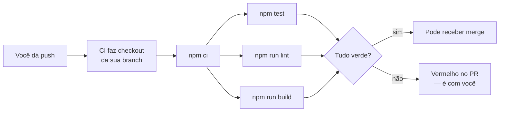
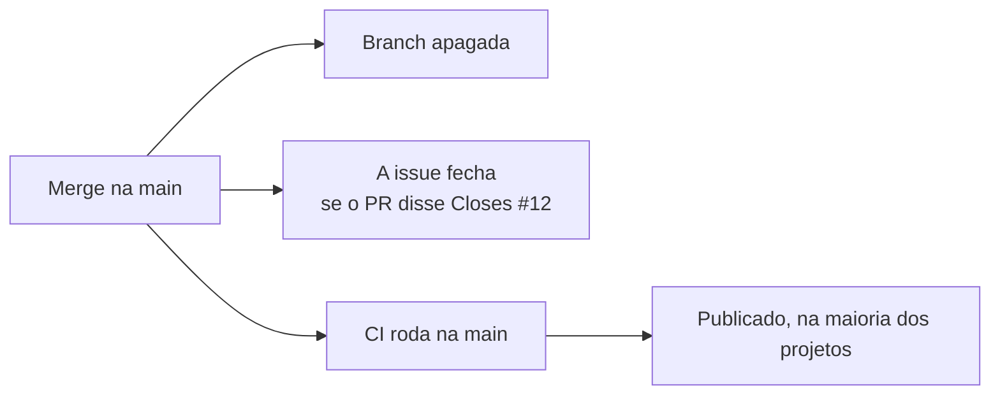

Segunda vez. Você levou a alteração da página inicial até o fim na etapa
{{step:first-pull-request}} — push, abrir, descrever, revisar, fechar — então a
mecânica não é novidade.

O que é novo é que a alteração vale ser revisada. Uma edição de título não tem
nada sobre o que discordar; um modelo, um endpoint e uma página têm decisões
dentro. Esta etapa é a parte do processo que só passa a importar quando isso é
verdade: o que rodar antes de dar push, o que roda depois, e como ser revisado e
como revisar.

=== attest=green-before-push
## Antes de dar push

Dois comandos. Rode nesta ordem, toda vez, pelo resto da sua carreira:

```bash
npm test
```

```bash
npm run lint
```

**O linter não é sobre estilo.** O [ESLint](https://eslint.org/docs/latest/) é
configurado pelo projeto, e pega uma classe específica de coisa que o verificador
de tipos não pega: um `useEffect` sem uma dependência, uma variável não usada que
significa que você apagou a linha errada, uma promise que ninguém aguardou. Parte
do que ele aponta é discutível. Corrija mesmo assim, ou discuta como mudança de
regra — uma base de código onde o linter está sempre vermelho é uma onde ninguém
o lê.

A maior parte do que ele reclama, ele consegue corrigir:

```bash
npm run lint -- --fix
```

:::note É o tempo de quem revisa que você está protegendo
Todo teste falhando e todo erro de lint que quem revisa encontra é uma ida e
volta: a pessoa lê, comenta, espera, lê de novo. Qualquer coisa que uma máquina
poderia ter te dito em trinta segundos nunca deveria chegar a uma pessoa.
:::

=== check=sandbox-branch,pushed,readable-history
## Push

```bash
git push -u origin sandbox/seu-nome
```

`origin` é o nome da cópia do repositório no GitHub. O `-u` liga sua branch local
à remota, para que daqui em diante um [`git push`](https://git-scm.com/docs/git-push)
simples e o `git pull` saibam para onde ir.

Se falhar, leia o erro antes de tentar de novo. “Permission denied (publickey)”
significa que a autenticação da etapa {{step:git-setup}} não está configurada,
não que você deu push errado.

=== ask=history-recall
## O que quem revisa está prestes a ver

Antes de abrir: seus commits são a primeira coisa que a pessoa lê.

=== attest=opened
## Abra o pull request

Um **[pull request](https://docs.github.com/pt/pull-requests)** é um pedido para
fazer merge da sua branch na `main`. É onde a revisão acontece: o diff, os
comentários linha a linha e a conversa, tudo num lugar só.

No GitHub, sua branch aparece com um botão “Compare & pull request”. Base:
`main`. Compare: sua branch.

:::note Sim, este é um segundo pull request na mesma branch
A etapa {{step:first-pull-request}} disse para não abrir um novo quando você tem
alterações a acrescentar — e está certo, enquanto um pull request está aberto.
Você fechou aquele, então este é um pedido novo sobre a mesma branch.

O diff dele carrega tudo o que está na branch, incluindo a alteração de título da
semana um e o commit de merge da etapa {{step:conflicts}}. Isso é normal e vale
uma linha na sua descrição: diga para que a alteração serve, e quem revisar,
ao ler alguns commits mais antigos, não vai ficar em dúvida se deveriam estar
ali.
:::

=== attest=description,linked
## Escrevendo

A descrição é a primeira coisa que quem revisa lê e ela decide o quanto sua
revisão vai ser boa. Três coisas:

```markdown
## What

Adds `GET` and `POST /api/products`, a `Product` model, and a page at
`/products`.

## Why

Closes #12. The store needs products before anything can be sold.

## How to check it

1. `./script/server`
2. `npm test`
3. Visit http://localhost:3000/products and add a product

Prices are stored as integer cents — `priceCents` — rather than a decimal,
to avoid floating point rounding on money.
```

`Closes #12` não é só uma anotação: o GitHub vincula os dois e fecha a issue
automaticamente quando o PR recebe merge.

Aquele último parágrafo é o que as pessoas deixam de fora e o que quem revisa
mais quer. Se você tomou uma decisão de julgamento, diga qual foi. Senão quem
revisa tem que adivinhar se você considerou a alternativa ou nunca pensou nela.

:::note Mantenha pequeno
Este PR está no lado grande — um modelo, um endpoint, uma página. Quem revisa
lendo 600 linhas encontra menos problemas que a mesma pessoa lendo 150, três
vezes. Trabalho real é mais fácil de revisar, e entra mais rápido, quando
dividido: o modelo e o endpoint num PR, a página no seguinte.
:::

===
## O que roda sem você

Dar push normalmente dispara algo. Na maioria dos projetos um servidor de **CI**
— integração contínua — pega sua branch, instala a partir do lockfile e roda as
verificações numa máquina que não é a sua.



Os resultados aparecem no próprio pull request, como uma fileira de vistos ou
cruzes.

**Uma verificação vermelha é seu trabalho, não de quem revisa.** E também não é
um julgamento — a CI de todo mundo fica vermelha. O que importa é a distância
entre ela ficar vermelha e você perceber.

:::note “Na minha máquina funciona”
É para isto que a CI existe, e é por isso que ela instala com `npm ci` em vez de
`npm install` — o lockfile exatamente, sem faixas resolvidas de novo. Quando algo
passa localmente e falha lá, a diferença quase sempre é algo que só existe na sua
máquina: um arquivo que você esqueceu de commitar, um valor do `.env`, um pacote
que você instalou e nunca adicionou ao `package.json`.

Clique na verificação que falhou e leia o log. É a mesma saída que você teria
localmente, num lugar em que você não está acostumado a olhar.
:::

=== attest=reviewer,responded quiz=review-feedback
## Sendo revisado

Alguém vai comentar no seu código. Algumas coisas que a pessoa disser vão estar
certas, algumas vão se basear em algo que ela leu errado, e algumas são
preferência.

Três coisas que vale internalizar cedo:

**É sobre o código.** “Isto poderia ser mais simples” é uma afirmação sobre uma
função. Não existe versão disso que seja sobre você, por mais que soe assim de
primeira.

**Uma pergunta normalmente é uma pergunta.** “Isto poderia ficar numa função
simples para ser testado diretamente?” significa o que diz. Duas respostas
servem: *boa ideia, feito*, e *tentei e precisa do objeto da requisição — mudo com
prazer se você ainda achar melhor*.

**Responda a tudo.** Mude, ou diga por que não. Um comentário sem resposta soa
como ignorado, e quem revisa tem que decidir se levanta de novo.

Depois dê push de mais commits na mesma branch — o PR se atualiza sozinho. Não
abra um novo.

=== attest=reviewed-one
## Revisando outras pessoas

A etapa {{step:first-pull-request}} te pediu para ler o pull request de outra
pessoa. Aqui está como fazer isso direito.

Vão te pedir antes de você se sentir qualificado. Faça mesmo assim — quem lê sem
já saber como o código funciona é exatamente quem encontra as partes que só fazem
sentido para quem já sabe.

**Leia nesta ordem.** Não de cima para baixo.

1. **A descrição.** Para que serve isto? Se você não conseguir dizer, esse é seu
   primeiro comentário, e é um comentário de verdade.
2. **Os testes.** Eles te dizem o que quem escreveu acha que o código deve fazer,
   mais rápido que o código. Uma alteração sem teste é uma pergunta legítima: o
   que quebraria se isto estivesse errado?
3. **O código**, agora que você sabe o que ele está tentando fazer.
4. **Baixe a branch e rode**, para o que você não conseguir resolver lendo.

**O que de fato dizer.** Mais ou menos em ordem de valor:

| Vale dizer | Não vale dizer |
| --- | --- |
| “Não consigo acompanhar esta parte” | Qualquer coisa que o linter pegaria |
| “O que acontece se isto estiver vazio?” | Reestilizar conforme sua preferência |
| “Isto não está testado — foi deliberado?” | “Nit:” repetido onze vezes |
| “Isto duplica X em `lib/`” | Reescrever do jeito que você teria feito |

**Pergunte em vez de mandar.** “Isto deveria ser `422`?” convida a resposta “não,
porque…” e você pode estar errado. “Mude isto para `422`” não convida, e você
ainda pode estar errado.

**Diga o que está bom.** Uma revisão que é só crítica é exaustiva de receber e não
diz a quem escreveu nada sobre o que continuar fazendo. Custa uma linha.

**E aprove.** Uma revisão que termina sem decisão deixa quem escreveu travado. Se
seus comentários são coisas que você gostaria de ver corrigidas mas não precisa
rever, aprove e diga isso. Bloquear deveria ser raro e explícito.

:::try
Ache outro pull request aberto — de um colega, ou de qualquer repositório público
que você use. Leia na ordem acima e deixe um comentário que seja uma pergunta
genuína.

A primeira revisão que você escreve é aquela em que você descobre quão pouco de
um diff dá para acompanhar sem a descrição.
:::

===
## O que um merge faria

Você não vai fazer merge deste — é um sandbox, e a `main` fica exatamente como
você a encontrou. Mas você não deveria conhecer o botão pela primeira vez num
trabalho real, então aqui está o que ele faz.

Aprovado, verificações verdes, e alguém aperta. O GitHub oferece três formas, e
times normalmente escolhem uma e ficam com ela:

| | O que entra na `main` |
| --- | --- |
| **Squash and merge** | Todos os seus commits achatados em um, com o título do PR. O padrão mais comum. |
| **Merge commit** | Todos os seus commits, mais um commit registrando o merge. |
| **Rebase and merge** | Todos os seus commits, reaplicados no topo, sem commit de merge. |

Depois, em ordem:



Três coisas decorrem disso e surpreendem as pessoas:

**Sua branch é apagada, e está tudo bem.** Os commits estão na `main` agora. A
branch nunca foi mais que uma etiqueta.

**A issue fecha sozinha**, se sua descrição disse `Closes #12`.

**Normalmente vai para produção**, nos projetos que publicam automaticamente. A
distância entre “mergeado” e “os clientes têm” muitas vezes é de minutos.

:::note Seu primeiro PR mergeado
Outra pessoa aperta o botão, ou você aperta depois da aprovação — varia por time,
e é uma boa coisa para perguntar no primeiro dia. O que não varia: depois que
entra, `git switch main && git pull` antes de começar a próxima coisa. Trabalhar
numa `main` desatualizada é como você acaba com os conflitos da etapa
{{step:conflicts}}.
:::

:::warn Este aqui é fechado, não mergeado
Abra, receba revisão, responda aos comentários — e então **feche sem fazer
merge** na etapa {{step:cleanup}}. O trabalho foi real; a branch não é.
:::
